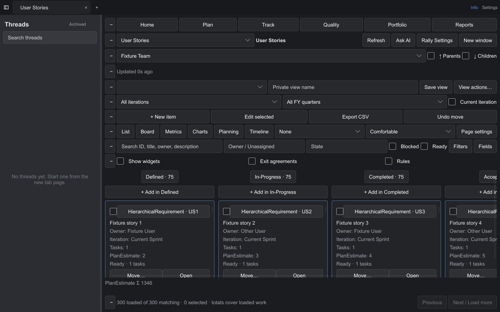
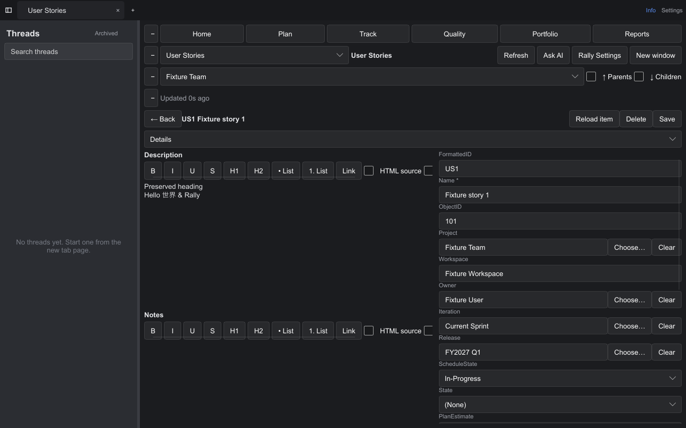
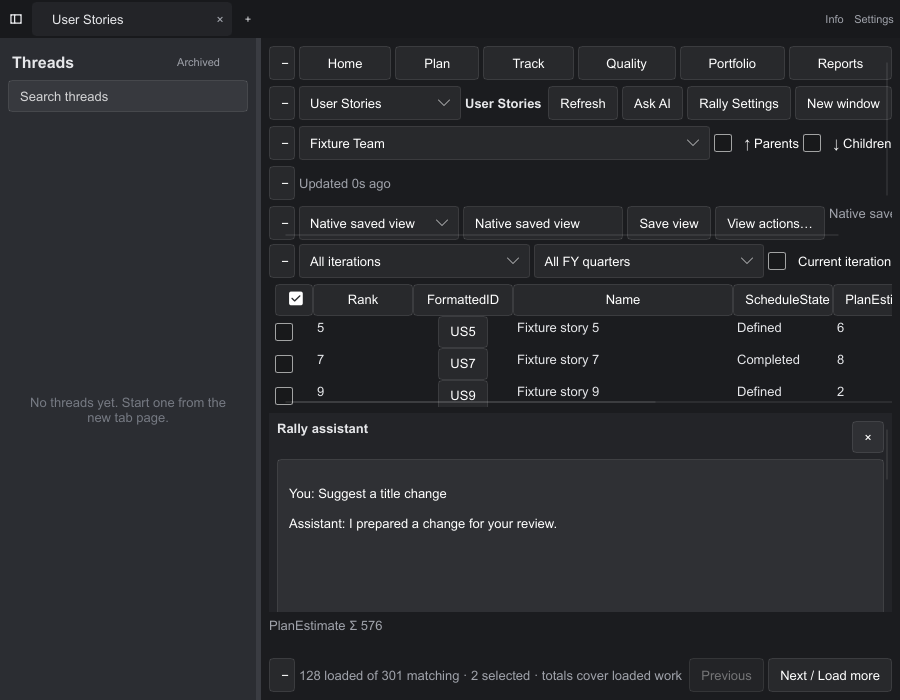

# Rust/Slint port verification

The Windows x64 fast build passed the fixture acceptance suite on `games` on
2026-10-10. All 676 headless Rust tests passed on the Mac. The Mac executable
compiled successfully; no GUI was launched on the Mac.

The original Rally layout and behavior accounting, source-function index and
R01–R22 implementation ledger are in [RALLY-INVENTORY.md](RALLY-INVENTORY.md).
The imported codex-gui revision is `be94e52cc21c5d262805e044e75267885bc73a3d`;
the preserved Go baseline is `f523c6b7ae6f9b6a12ca951845b56d81cb76a879`.

## Commands and outcomes

| Check | Outcome |
|---|---|
| `python3 dev/check-build-policy.py` | Passed; dev/release/test and build-script settings, flags and entrypoints checked |
| `cargo fmt --all -- --check` and `git diff --check` | Passed |
| `cargo test --locked --lib -- --skip window_runtime::tests` | 676 passed, zero failures, one GUI test filtered out on the Mac |
| `cargo xwin build --locked --target x86_64-pc-windows-msvc --bin fastrock` | Passed, dev/unoptimized; final incremental build 1 minute 20 seconds |
| `python dev/windows-rally-smoke.py fastrock.exe`, interactive session on `games` | Passed; 82 fixture requests and 13 explicit writes |
| Hosted Windows [run 38036468741](https://github.com/allquixotic/fastrock/actions/runs/38036468741), alpha.2 source | 667 Rust tests, compilation, CI-mode fixture acceptance and packaging passed; incremental cache saved |
| `cargo build --locked --bin fastrock`, Mac | Passed, dev/unoptimized; final incremental build 1 minute 24 seconds |
| Installed Mac Codex CLI 0.162.0, read-only stdio initialize/config/model-list | Passed; seven models returned, no inference or Rally writes |

Toolchain: Rust 1.95.0; native Slint 1.18.1 software renderer. Timings describe
these machines and their existing caches, rather than a promised cold-build time.
Two retained upstream compatibility/dead-code warnings remain on Windows; the
Mac also reports an unused platform-specific interruption helper. No compile
errors remain.

The exact executable exercised on `games` has SHA-256:

```text
e816033be6f99eeac89271e7a2610f2a0132aa2159e783e2fa42fd6aec6bfe49
```

`BUILD.json` inside each package records the source commit, dirty status, binary
hash, profile, upstream pins and external Codex prerequisite. A GitHub-built
binary has its own hash and fixture run. The packaging script never recompiles
or optimizes; ZIP entries are stored without a compression pass.

## Native Windows coverage

The suite launches the actual Slint executable with a loopback WSAPI fixture and
an external stdio Codex fixture. It records requests without authorization
headers and retains screenshots, state dumps, session files, an executable hash
and `acceptance.json` under `build/rally-smoke` on Windows. The local final copy is
`build/rally-windows-alpha3-evidence`. These generated outputs are ignored by Git.

Coverage includes horizontal document tabs, a chats-only sidebar, list paging,
300-card board paging, mixed concrete artifact types, vertical Owner swimlanes,
card-field settings, relative ranking and Undo. A Windows mouse gesture actually
drags a card between workflow lanes. A native User-picker button click is checked
for closing the picker and supplying a typed reference to bulk review.

The remaining settled callback scenarios cover typed edit/save, create with the
Completed-lane default, related Tasks/Attachments/Revisions/Discussions reads,
posting a discussion, rich HTML source save, sparse mutation responses, late
edits during delayed normal and Save-and-continue saves, retained in-flight write
guards on invalid input,
paging to the created artifact, dirty-navigation
Save/Discard/Cancel, private-view snapshots, unapplied-filter isolation, row
hide/restore, reviewed bulk updates, an assistant proposal followed by explicit
human Apply, narrow layouts, restart with unsaved fields/comments, and popout
plus transfer back with drafts and filters preserved. Assertions inspect the
corresponding request payloads and persisted state rather than button names alone.

Hosted runners use `--ci` to drive the board move callback rather than an OS mouse
gesture. The default suite on `games` still requires the real gesture. Alpha.1's
hosted run passed 665 Windows Rust tests and compilation, then failed its OS-drag
assertion. The follow-up hosted run passed all 667 Windows Rust tests and the
callback-mode fixture suite (80 requests/12 writes), then packaged successfully
and saved its incremental cache. Its source precedes the final Save-and-continue
fix; alpha.3 passed both fixture modes on `games` with 82 requests/13 writes.
The acceptance receipts explicitly record their modes, and CI retains evidence
even on failure.
The final alpha.3 hosted run 38039008786 also passed 667 Windows Rust tests,
the complete 82-request/13-write callback fixture suite, packaging and cache save.

HTTP and pure Rust tests also exercise complete collection paging, full-query
CSV scope and formula neutralization, malformed or changing pages, reference and
type guards, token redaction, mutation non-retry, revision conflicts, attachment
size/download/orphan cleanup, stale cache invalidation, three-way merge, partial
batch outcomes, acknowledgement/collection-summary/late-edit merging and legacy
settings/session migration. Transport tests cover
timeouts, cancellations, bounded frames/events and disconnect cleanup.







## Scope and distribution

The alpha.3 recorded above is an unsigned Windows x64 alpha. It requires installed Codex CLI 0.162.0 or
newer; the installed CLI owns inference and configuration. `games` did not have
Codex on its interactive PATH, so its UI tests used the explicit external-process
fixture. The real installed CLI was checked read-only on the Mac.

No real Rally endpoint or token was used and no real Rally write was made.
Attachment file dialogs and individual DPI scaling configurations are implemented
but were not driven in this acceptance run. Vault key compatibility was checked
without replacing live credentials. Rich source preserves HTML beyond the
supported native formatting subset. Revision preflight cannot make WSAPI writes
atomic, and batch outcomes deliberately describe partial success.

Free space remained approximately 2.1 TiB on the Mac and 3.06 TB on `games`.
No cleanup was needed; useful incremental caches were retained. The build policy
and disk-space practice are persistent in AGENTS.md and docs/releases.md.

## Signed CI release: alpha.4

[v0.2.0-alpha.4](https://github.com/allquixotic/fastrock/releases/tag/v0.2.0-alpha.4)
was built, signed, verified, attested and published by
[CI run 38048069773](https://github.com/allquixotic/fastrock/actions/runs/38048069773),
source `32ab8aeb93dcd7401c32fc3392a19178daf01286`. The port was pushed directly
to main with existing history preserved. Future releases use this CI workflow;
PRs and locally published release binaries are excluded by AGENTS.md.

The build job used this Mac's persistent incremental cache and completed in
5m26s, including both platform binaries and 676 passing headless Rust tests.
Every invocation reported an unoptimized profile. The Windows job did no Rust
compilation and published its signed ZIP immediately after its checks. CI did
not archive the multi-GB build cache or compress binary artifacts/packages.

Windows Authenticode status was Valid for
`CN=Sean McNamara, O=Sean McNamara, L=Pasadena, S=MD, C=US`, certificate SHA-1
`59DE4BFCDD5B9C3B31CB3C591B2755BDA0969F07`, with Microsoft RFC 3161 timestamping.
The exact signed executable SHA-256 is
`72a87578ba6fbe0ed6beaeb258c2c269c1ccd5ba711aeb42f8417a3714103d3f`.
CI's native callback suite passed 82 requests/13 fixture writes on those bytes.
The downloaded published ZIP was independently checked against its SHA-256,
BUILD.json and GitHub attestation. On `games`, the extracted executable's
Authenticode signature was independently Valid, and the full physical mouse
suite passed 82 requests/13 writes, including native user-picker clicks.
ZIP SHA-256:
`bb37e4d65de22c81cebfa8b557df4f67df6c037d2518da009c45f98234b93b31`.

The Apple Silicon Mac app and uncompressed DMG use Developer ID Application
SHA-1 `9A3CFFC04D3472208A62C48E707EA6D4261998A1`, team `B6XDYNLMPU`, secure
timestamps and hardened runtime, without JIT entitlements. Its dependencies
were Apple system libraries only. Apple notarization submissions were:

- App: `87b0224b-f985-410b-bbd9-cd1312993a7f` — Accepted; log inspected.
- DMG: `32f269db-b4bf-464c-a4c0-1d5e4b12a8dc` — Accepted; log inspected.

CI stapled/validated the app before creating the DMG, then signed/notarized/
stapled/validated the DMG. Gatekeeper accepted the app, DMG and mounted app.
The final published DMG's checksum and GitHub attestation were independently
verified after download. DMG SHA-256:
`73a0092a79359158f1fbd0a70045fdd1cac5662b0ff467bf7888eace3a0c27c7`.
No Mac GUI was launched. Both temporary CI runners removed their registrations;
the useful incremental cache was retained. Mac free space was about 2.4 TiB;
`games` about 3.06 TB. No cleanup was required.

## Rally enum metadata regression: alpha.5

The reported Team Board error matches a client-side metadata bug: a generic
collection duplicate check treated each built-in enum's literal `_ref: "null"`
as the same object identity. Board loading queries both artifacts and their
schema/workflow; the error can therefore originate from dropdown metadata.
[Broadcom KB 57584](https://knowledge.broadcom.com/external/article/57584/wsapi-api-get-allowedvalues-for-rally.html)
shows distinct `StringValue` choices with this shared placeholder and complete
catalog responses using `StartIndex: 0` / `PageSize: 0`. Previous fixtures omitted
these response forms. No production subscription or token was accessed.

The fix applies only to `AttributeDefinition/<signed nonzero ID>/AllowedValues`.
It preserves all anonymous choices and normalizes a zero index only for the
first complete catalog. Duplicate persisted references, partial catalogs,
ordinary zero-index pages and repeated later pages remain rejected. Existing
workspace scoping and same-origin reference checks are preserved.

Four named `rally::client::tests::v24_*` regressions cover enum preservation,
unpaged response handling, real duplicate rejection and Team Board artifact +
schema + workflow loading. Before the fix, three failed with the duplicate/page
errors and the persisted-duplicate guard passed. After the fix, all 680 headless
tests passed; the Mac GUI test was excluded. Fast build policy, formatting,
Python syntax and diff checks passed. The Windows fixture now returns the
documented enum response and asserts every Team Board workflow lane survives.

Local headless evidence: `build/alpha5-headless.log`. Signed CI release receipts
are recorded after publication below.

[v0.2.0-alpha.5](https://github.com/allquixotic/fastrock/releases/tag/v0.2.0-alpha.5)
was built, signed and published by
[CI 38077735206](https://github.com/allquixotic/fastrock/actions/runs/38077735206),
source `311c2e4b1a362744e96b1750c35bd9106ad2aa09`. All three jobs passed.
Both platform binaries plus 680 headless tests completed in the 4m03s build
job, using the persistent cache and unoptimized profiles. Windows signed
fixture acceptance and independent physical mouse acceptance on `games` each
passed 82 requests / 13 fixture writes, explicitly recording
`realistic_allowed_value_metadata: true`. All four Team Board workflow lanes
survived; edit/drag/rank/undo/restart/window-transfer checks also passed.

The downloaded published Windows executable independently verified as Valid
Authenticode for Sean McNamara, with Microsoft RFC 3161 timestamping.
Executable SHA-256:
`abec190c7238ceea15b820be6d5aa74ddda1af01540bec8093bcd43bed420f51`.
ZIP SHA-256:
`f3c2b7419f30e47c2fb4f49444235b7d5bbe6fff35bcc933ae18332e569f36fb`.

The Mac app and DMG used pinned Developer ID
`9A3CFFC04D3472208A62C48E707EA6D4261998A1`, team `B6XDYNLMPU`.
App submission `2bcc0d2a-06a0-4190-814d-e11fcd555939` and DMG submission
`bed2a1a4-6f27-40a2-9f4a-a0834ad29081` were Accepted; both retrieved logs
had no issues. App and DMG stapling validated; Gatekeeper accepted the app,
DMG and mounted app. Published DMG SHA-256:
`60fcdc9e210b0e256c864dfb7bff1bb69ea6f66aff1150eee11ffebd5157006d`.

Both downloaded package checksums, Windows BUILD.json and GitHub attestations
were independently verified against the exact tag/source/workflow. Evidence:
`build/ci-alpha5-evidence/` (CI logs, signature/notarization records, hosted and
physical Windows fixture receipts) and `build/ci-alpha5-download/` (published
bytes and attestations). Both temporary runners deregistered; zero remained.
No production Rally access/writes or Mac GUI launch occurred. Mac free space
was about 2.4 TiB, games about 3.06 TB; active incremental caches retained.

## Official optimized 0.2.0

[Fastrock 0.2.0](https://github.com/allquixotic/fastrock/releases/tag/v0.2.0%2Bbuild.1)
is a published, non-draft, non-prerelease GitHub release marked latest. The
application version is exactly `0.2.0`; tag `v0.2.0+build.1` identifies the
packaging correction. Source: `780dfade69930ba2f325f2326f719d927609bf5b`.
[CI 38101740788](https://github.com/allquixotic/fastrock/actions/runs/38101740788)
passed all three jobs and published all ten assets.

Sean explicitly authorized `opt-level=1`, full `debug=2`, packed debug symbols,
`lto="off"`, `strip="none"`, 256 codegen units and incremental compilation for
this official version. Captured rustc invocations confirm optimization, debug
information and LTO settings for the application and protocol/config crates.
`lto="off"` disables local ThinLTO too. Other/default profiles and prereleases
remain unoptimized and prioritize compile speed.

Initial compilation took 6m28s for Windows and 6m49s for Mac. The first CI run
passed 680 headless tests but rejected the valid Mac dSYM because Cargo retains
a hash-suffixed filename inside it. The checker now resolves the DWARF file and
verifies UUID plus nonempty debug-info/line sections; a hashed-name regression
covers this case. The original `v0.2.0` tag was preserved. The corrected run
reused both binaries (0.88s/0.82s Cargo checks), completed its build job in 37s,
passed all 680 headless tests and four release-policy/symbol tests, and required
no second optimization pass. Windows signing/testing/publication took 5m56s;
Mac signing/notarization/publication took 3m42s.

Windows Authenticode and Microsoft RFC 3161 timestamp verification passed in
CI and independently on `games`. Publisher:
`CN=Sean McNamara, O=Sean McNamara, L=Pasadena, S=MD, C=US`;
certificate SHA-1 `ADBCA762010281BC5063C83068FD17E37C1EF6D2`.
Signed executable SHA-256:
`b0fe734f88abd724fc20549df0d9447fb92e67e0747a71d5a87b62ce48f34ec1`.
Hosted callback tests and physical mouse tests on the downloaded executable
each passed 82 requests / 13 fixture writes. The physical run confirms native
dragging and user-picker clicks; both runs record realistic allowed-value
metadata and cover the Team Board regression, editing, restart and window
transfer. The physical swimlane screenshot was also inspected.

The downloaded Windows PDB matches CodeView GUID
`b202a3cf-ddba-3329-4c4c-44205044422e`, age 1. LLVM independently confirms debug
information, types, globals and publics are present and the PDB is not stripped.
The downloaded Mac dSYM matches the signed app inside the published DMG:
UUID `BED72D69-F3F4-3DEF-BB21-9A9C1FBD0B95` (arm64), with nonempty DWARF info
and line sections. Symbol manifests identify the same source, workflow run,
compiler settings and signed executable hashes as the application packages.

Mac Developer ID SHA-1 `9A3CFFC04D3472208A62C48E707EA6D4261998A1`, team
`B6XDYNLMPU`, was used throughout. Apple accepted app submission
`21ea83c3-f16b-461d-8953-166df262d5d8` and DMG submission
`f2e52c47-da77-4968-bf70-b677768b29d4`; both logs have no issues. CI verified
stapling and Gatekeeper on app, DMG and mounted app. Independent checks of the
downloaded DMG verified signatures, app/DMG staples and Gatekeeper again.
Signed Mac executable SHA-256:
`64a2fb081ec3dd0ebe2f6c57dc981e6d7ba6b92296c99414e532dc0602a8838c`.

All four downloaded packages match their SHA-256 sidecars and GitHub asset
digests. Their bundled GitHub attestations independently verify against the
exact source, tag and `.github/workflows/release.yml`:

| Asset | Bytes | SHA-256 |
| --- | ---: | --- |
| Windows application ZIP | 65,034,804 | `b5754875a8fecc519f46bee7497cabd863c121664b83c0bcf5be393c981cdc2f` |
| Windows PDB ZIP | 1,376,967,419 | `4c60adf3a23c047971bad90749865fde7e756a8ebff0aaf83d0ed9a363696e7c` |
| Mac application DMG | 124,643,821 | `498073ae09abd50d285cf4e36dd538a33725644bbe275ba3279a460a4c25921b` |
| Mac dSYM ZIP | 1,025,275,158 | `79dd66e95e773de7133814d31d97df268039075461ebc63727b4d92ae2c6e552` |

Evidence is retained in `build/ci-020-evidence/` (CI, signing, symbols,
attestations and physical fixture receipts) and `build/ci-020-download/`
(published bytes). Both temporary runners removed their registrations; zero
remained. No Mac GUI or production Rally calls/writes occurred. Mac free space
remained about 2.3 TiB and games about 3.06 TB; active caches were retained.


## Goose ACP migration — 0.3.0-alpha.1

The default backend launches installed Goose ACP over stdio. Source inspection of
Goose v1.56.0 confirms independent sessions and prompt tasks within one process;
`goose serve` uses the same ACP handler. See [architecture](goose-acp.md).
No Goose crate was added to Cargo.lock. Both platforms use the fast dev profile.

Windows verification on `games` covers the full Rust suite (681 passed; the one
window-runtime unit test is excluded in favor of native UI acceptance), including
11 Goose adapter tests. Three release-policy tests pass; the Apple-only symbol
fixture is skipped on Windows. Native automation uses a separate Python ACP
process and loopback Rally/MCP fixtures, with no real inference or Rally writes.
Two conversation tabs stream independently; stopping the first does not stop the
second. Screenshots verify the native Goose option controls. The Rally suite
covers 82 HTTP requests and 13 explicit fixture writes, proposal review/Apply,
drafts, restart and window transfer. `--ci` uses native board callbacks: no
physical mouse test was possible because no interactive user was signed in.

CI repeats the Rust and native Goose/Codex UI checks on Windows, on the exact
signed release executable for the UI runs. The Mac only compiles and performs
signing/notarization verification; it runs no tests or GUI. CI evidence includes
`goose-chat-smoke`, `goose-rally-smoke`, `rally-smoke`, Windows test output and
signature receipts. A live provider account has not been exercised.

Release verification completed 2026-10-26:

- Source commit: `b611ffe3c2eb87c30cab1ecd8ce77cfa6121a73e`.
- [Signed CI run 40267148011](https://github.com/allquixotic/fastrock/actions/runs/40267148011): build, Windows and macOS jobs succeeded.
- [Published v0.3.0-alpha.1](https://github.com/allquixotic/fastrock/releases/tag/v0.3.0-alpha.1): Windows x64 ZIP and Apple Silicon DMG, each with checksum and attestation.
- Windows: 681 Rust tests passed; Goose chat, Goose Rally and Codex Rally UI
  acceptance passed. Every UI receipt matches signed executable SHA-256
  `b88a380f5703ef6764fb7013733607f6cf7e56583bbee2d74157abcffe438a36`.
  Authenticode publisher is Sean McNamara; Microsoft RFC 3161 timestamp verified.
- Mac: app and DMG notarization both Accepted; signing, stapling and Gatekeeper
  verification passed without launching the app. Both temporary CI runners were
  removed after completion. Local evidence is retained under
  `build/goose-verification/`; CI artifacts retain the published-source receipts.

## Stable 0.3.0 virtual workspaces — 2026-10-26

- [Stable release v0.3.0+build.1](https://github.com/allquixotic/fastrock/releases/tag/v0.3.0%2Bbuild.1)
  is public, latest and not a prerelease. Windows x64 ZIP only; Mac compilation
  passed without running Mac tests or GUI, and the Mac publication job was skipped.
- [Signed CI run 40382229798](https://github.com/allquixotic/fastrock/actions/runs/40382229798)
  succeeded from `3002f35fb14bb00690930db4384efd0d12585cec`. The temporary build
  runner was removed. Fast build settings remain opt-level 0, debug 0, no LTO.
- Windows: 690 application tests, five provider tests and four release-policy
  tests passed. One live-vwork test remains opt-in/ignored; one existing window
  runtime test is skipped in the headless test executable. Native Goose chat,
  Goose Rally, Codex Rally and virtual-workspace UI acceptance all passed on the
  exact signed executable. Hosted Rally uses callback-based board interaction.
- Virtual workspace evidence verifies the native window, preserving text on a
  revision conflict, a successful revision-checked save, and hidden controls with
  vwork disabled. The UI screenshot was inspected after downloading CI evidence.
- Azure Artifact Signing `allquixotic-signing/windows-public` produced valid Sean
  McNamara Authenticode signing and a Microsoft RFC 3161 timestamp. Certificate
  SHA-1: `0063631B695A60361BF66A861649BD0CB7F91CB2`. Signed executable SHA-256:
  `61dfb942633dc414bafd8f68423bafdc455965767b021bcab5b34a5841e27067`.
- ZIP: `fastrock-0.3.0-windows-x64-fast.zip`, 145,777,592 bytes, SHA-256
  `c830f129682c798ff0a91e9b429ffa40e68157d60490d781ba7309d917b33200`.
  Downloaded bytes match the checksum, GitHub asset digest and embedded signing
  receipt; GitHub provenance verification passed for the exact source/tag/workflow.
- [S3 fastrock.zip](https://fastrock-dl-582961286906-us-east-1-an.s3.us-east-1.amazonaws.com/fastrock.zip)
  contains identical bytes. The explicitly invoked ship-to-aws helper verified
  anonymous HEAD and full-download SHA-256, REDUCED_REDUNDANCY storage and denied
  anonymous bucket listing. Failed tag v0.3.0 remains unchanged; B72 records the
  runner PSGallery registration fix included in the successful build tag.

## 0.3.1 vwork maintenance — 2026-10-26

- [Release v0.3.1](https://github.com/allquixotic/fastrock/releases/tag/v0.3.1)
  and [signed CI 40425525614](https://github.com/allquixotic/fastrock/actions/runs/40425525614)
  succeeded from `58fa5da5014d120b6e45e57d32f5bee12d874da1`. Windows x64 fast ZIP;
  Mac compatibility compilation passed with no local Mac tests/GUI. The temporary
  build runner was removed and its incremental cache preserved.
- 691 application tests, six workspace-provider tests and four release-policy
  tests passed. The existing live-vwork opt-in test remains ignored and the
  headless-incompatible window-runtime test remains skipped. Signed native
  Codex Rally, Goose Rally/chat and virtual-workspace acceptance passed.
- The compact action calls the selected store in the background, shows measured
  reclaimed bytes or skip/error reasons, and preserves unsaved drafts. Native
  fixture evidence and the inspected screenshot show the button, successful
  compaction report and preserved draft; disabled vwork hides the feature.
- Authenticode publisher: Sean McNamara; Microsoft RFC 3161 timestamp present.
  Certificate SHA-1 `F65E5B72C3747B4450FC367E1AD28B15F1418729`.
  Executable SHA-256:
  `d8e6044139aa229ea200ae2464f2a5e65273ee728e4001e2e5cb72cf2e9db750`.
- Downloaded ZIP `fastrock-0.3.1-windows-x64-fast.zip`: 145,959,360 bytes;
  SHA-256 `10648b312c46ec89993aa4dbd8a81db44f66742303813651c6362f36031e1304`.
  GitHub asset digest, checksum and signing receipt match. GitHub provenance
  verified against the exact source, tag and release workflow.
- Explicit ship-to-aws upload overwrote
  [fastrock.zip](https://fastrock-dl-582961286906-us-east-1-an.s3.us-east-1.amazonaws.com/fastrock.zip)
  with identical bytes using REDUCED_REDUNDANCY. Anonymous HEAD size/class and
  full-download SHA-256 passed; anonymous bucket listing remained denied (403).

## 0.3.2 scrolling performance — 2026-10-26

Development benchmark ran in the signed-in console session on `games` (Windows 11
26100, software renderer). Identical local ACP fixtures and native wheel events
were used before and after; 360 input ticks per scenario at 1440×1000/100%,
120 at 2560×1600/200%. First ten samples were excluded. Renderer timings include
rasterization and presentation; event-loop intervals additionally expose layout
and dispatch stalls. The 16.667 ms input timer is a pacing target, not an input-to-
photon latency measurement. No inference or real Rally requests were used.

Baseline is c7374dd behavior plus in-memory diagnostics, all opt-level 0 and the
original full-window invalidation. Candidate retains application opt-level 0,
optimizes 17 rendering/text dependencies at level 2, disables all LTO (including
local ThinLTO), retains a private Windows framebuffer, and virtualizes tables in
eight-row chunks and tool/command/diff output in sixteen-line chunks.

| Scenario | 100% frame p95, before → after | 200% frame p95, before → after | 100% event-loop interval p95, before → after |
|---|---:|---:|---:|
| prose | 63.90 → 7.45 ms | 120.51 → 13.20 ms | 72.49 → 17.24 ms |
| table | 56.93 → 6.65 ms | 81.45 → 9.94 ms | 140.62 → 18.23 ms |
| code | 41.00 → 5.43 ms | 81.69 → 9.55 ms | 42.29 → 17.26 ms |
| tools | 45.36 → 6.79 ms | 87.66 → 9.13 ms | 47.17 → 17.39 ms |
| streaming | 68.76 → 7.75 ms | 125.28 → 12.83 ms | 81.84 → 17.20 ms |

Baseline executable SHA-256: `8d6fe39c2193d9ca7d7fe9e1becf0c1c7ead025a033f835be1ee5bcb731c0f43`.
Candidate executable SHA-256: `6604f3a25e7c5b04e7aae484a31b44ba29c10043e91c0f0d98d4fd72964a004a`.
All baseline frames dirtied the entire window; candidate scrolling typically
dirties only the conversation region. Presentation still copies every pixel to
Windows so RDP buffer loss cannot expose stale pixels. Private storage costs
approximately four bytes per physical window pixel.

Raw frames, timing summaries, snapshots and local binaries are retained in
`build/scroll-benchmark/` and `games:C:/Users/SeanMcNamara/fastrock-scroll-032/`.
The reusable fixture is `dev/windows-scroll-benchmark.py`. These are development
measurements; hosted CI runs a shorter acceptance fixture on the signed executable,
without imposing machine-independent timing thresholds.

Windows regression evidence: 695 application tests plus the isolated rendering
test passed; six provider fixture tests passed, one live-vwork test stayed ignored.
Three release-policy tests passed; the Apple symbol fixture was skipped on Windows.
Rendering tests corrupt the presentation buffer, verify unchanged content needs
zero rasterization, verify a small visual change remains a partial repaint, and
check resize storage, links, clipping and selection. Native benchmark exercises
minimize/restore. Actual RDP reconnect was not driven; surface loss is injected
deterministically. Mac compatibility compilation passed; no Mac tests or GUI ran.

Native acceptance on the candidate also passed both Codex and Goose Rally fixtures
(82 local requests and 13 explicit fixture writes each, real Windows mouse board
moves), concurrent Goose chat/cancel/config controls, and virtual-workspace
conflict/save/disabled-controls checks. All receipts bind to the candidate hash.

### Published CI artifact

[Signed release CI run 40441558745](https://github.com/allquixotic/fastrock/actions/runs/40441558745)
passed and published [v0.3.2](https://github.com/allquixotic/fastrock/releases/tag/v0.3.2)
on 2026-10-27 UTC from `d38db9e890025cc514a244d6e7e89310f9ff60eb`.
Windows ran 695 application tests, the isolated renderer test, six provider tests,
and release-policy checks. The live-vwork test stayed ignored. Mac compatibility
compilation passed; Mac publication was skipped. The temporary build runner was
deregistered after completion.

The exact signed executable passed CI's Codex/Goose Rally, concurrent chat,
virtual-workspace and five-scenario scrolling fixtures. Hosted Rally board moves
used callbacks; the pre-release games checks above exercised native mouse moves.
CI scrolling p95 render-plus-present times ranged from 6.64 to 12.53 ms at
1440×1000/100%; these hosted-runner figures are separate from the games comparison.

Downloaded `fastrock-0.3.2-windows-x64.zip` SHA-256 matched both the published
sidecar and GitHub asset digest:
`aa4d3e2f0ccee342f2bef205a231f9134c73b8d24f86a30ccba9c95134398106`.
GitHub attestation verification passed with repository, release workflow, tag and
source commit constraints. BUILD.json confirms a clean source tree, all 17
authorized dependency optimizations and `lto="off"`; signing and acceptance
receipts match the extracted executable SHA-256:
`44767d7917a65c5bd24cdbf00288d58b9037727f00cedcc8f446678113bdeb10`.
Independent Authenticode verification of that downloaded executable on games
returned `Valid`, publisher Sean McNamara, with Microsoft's timestamp authority.
Downloaded assets, CI receipts and local verification evidence are retained in
`build/scroll-release-0.3.2/`.

## Conversation opening investigation — 2026-10-29

`dev/windows-thread-benchmark.py` measured the published, signed 0.3.2 executable
with SHA-256 `44767d7917a65c5bd24cdbf00288d58b9037727f00cedcc8f446678113bdeb10`.
The same executable ran on games (Windows 11 x64 26100.9711, active console session)
and [hosted Windows CI run 40879417319](https://github.com/allquixotic/fastrock/actions/runs/40879417319).
CI independently verified the release checksum, attestation, executable hash,
Authenticode publisher and timestamp. All twelve samples per host passed.

Each sample starts a fresh native application process, waits for backend readiness,
then opens a conversation at 1440×1000/100% with software rendering. The local ACP
fixture has no provider, extensions, inference, credentials or external services.
New conversations use the normal folder-trust path in an isolated folder outside
Git. This measures conversation opening after application startup, not cold launch.

| Scenario | games request → thread response | games history availability upper bound | CI request → thread response |
|---|---:|---:|---:|
| new conversation | 18.5–23.7 ms | n/a | 8.0–9.0 ms |
| 10 saved turns, 26 KB replay | 5.3–6.5 ms | 104–308 ms | 3.3–3.5 ms |
| 2,000 saved turns, 5.3 MB replay | 225–287 ms | 411–655 ms | 165–166 ms |
| 200 turns with tool output, 15.3 MB replay | 288–516 ms | 662–907 ms | 287–294 ms |

Ranges cover three samples per scenario. Response timings use the existing
`thread-started` / `thread-resumed` milestones. The transcript export is sampled
every 100 ms until its latest-message sentinel is present. That history measure
includes polling and asynchronous export overhead; it is neither a first-pixel
measurement nor input-to-photon latency. Fixture delivery timing includes Python
serialization and pipe backpressure, so it cannot isolate Rust parsing CPU time.

Source inspection identified these optimization candidates:

- `src/goose/sessions.rs`: new conversations wait for `session/new`; resumed ones
  wait for the entire `session/load` reply before exposing history. Every history
  page clones all loaded items before taking at most 100; turn metadata also clones
  item payloads before discarding them. The shared session mutex covers that work.
- `src/goose/model.rs`: replay constructs presentation events, including cloned
  tool output, then clears them because replay only needs stored history.
- `src/transcript/store.rs`: first-page Markdown parsing and row conversion run
  on the UI thread. Row virtualization does not remove this initial preparation.
- `src/app.rs`: `save_prefs` writes synchronously, including the new-thread path.
  The measured new-thread fixture was still below 24 ms, so this alone does not
  establish the cause of the reported severe delay.

The [Goose ACP implementation](https://github.com/aaif-goose/goose/blob/v1.57.0/crates/goose/src/acp/server.rs)
starts extension leases during session activation before returning setup responses.
Its [load handler](https://github.com/aaif-goose/goose/blob/v1.57.0/crates/goose/src/acp/server/load_session.rs)
also replays stored conversation content. Provider/extension setup is therefore a
candidate shared by new and existing conversations. The installed-backend experiment
below confirms the dependency, but does not reproduce the user's configuration.

Evidence: `build/thread-benchmark-ci/`, `build/thread-benchmark-games-summary.json`,
and `games:C:/Users/SeanMcNamara/fastrock-thread-032/fixture/`. The manual
`thread-performance.yml` workflow permits repeating the same test against a signed
published release without rebuilding the application.

### Installed Goose on games

After explicit user authorization on 2026-10-29, installed the official
[`@aaif/goose-acp@1.57.0` package](https://github.com/aaif-goose/goose/tree/v1.57.0/ui/goose-acp)
through Bun 1.4.2 as the signed-in Windows user:
`bun add --global @aaif/goose-acp@1.57.0`. Both `where goose` and `goose --version`
passed in that user's session. The command shim is
`C:\Users\SeanMcNamara\.bun\bin\goose.exe`; the package's native x64 executable is
`C:\Users\SeanMcNamara\.bun\install\global\node_modules\@aaif\goose-binary-win32-x64\bin\goose.exe`,
SHA-256 `ee39aee30805fda80ed996a4e2e9940d04ec855436315b8deb96950231145242`.
No normal Goose provider configuration or credentials were changed.

`dev/windows-goose-benchmark.py` drives that installed command with a separate
`GOOSE_PATH_ROOT` per sample. A loopback OpenAI-compatible fixture answers model
discovery and produces one fixed response; no real inference or external tools run.
Four variants each have three fresh-process samples and two create/prompt/close/load
cycles. The empty-config variant retains Goose's default platform extensions;
it does **not** mean zero extensions. The Developer variant explicitly enables
the builtin Developer entry. The other two add the same local HTTP MCP server,
with either immediate initialization or an intentional 1,000 ms delay.

| Goose ACP variant | First new session | Second new session | Reload one saved turn |
|---|---:|---:|---:|
| Empty config / default platform extensions | 118–143 ms | 16–22 ms | 10–15 ms |
| Explicit builtin Developer | 129–140 ms | 18–20 ms | 10–33 ms |
| Default + immediate local MCP | 133–170 ms | 22–47 ms | 17–27 ms |
| Default + MCP delayed by 1,000 ms | 1,110–1,117 ms | 1,025–1,037 ms | 1,019–1,046 ms |

These direct ACP timings include no native UI. Reloads occur after `session/close`
in the same Goose process. The script also launches the same signed Fastrock 0.3.2
binary used above, with software rendering at 1440×1000/100%. Every GUI sample
starts a fresh application/backend process and waits for backend readiness before
opening. New conversations use Fastrock's normal folder path, including its default
cross-tab MCP bridge. Resumes load the saved fixture turn; MCP variants retain the
saved external MCP configuration. All eighteen GUI opens passed in the final run.

| Native Fastrock + installed Goose | New-thread response | Saved-thread response | Saved history availability upper bound |
|---|---:|---:|---:|
| Default platform extensions | 69–115 ms | 40–47 ms | 202–300 ms |
| Explicit builtin Developer | 63–72 ms | 43–54 ms | 201–302 ms |
| Saved immediate local MCP | n/a | 54–70 ms | 201–301 ms |
| Saved MCP delayed by 1,000 ms | n/a | 1,064–1,070 ms | 1,105–1,206 ms |

History availability uses the same 100 ms transcript-export sampling described
above, not first-pixel timing. In the delayed MCP direct-client samples, all saved
text arrived after only **3.2–6.8 ms**, while the final `session/load` reply took
**1,019–1,046 ms**. Fastrock's adapter buffers that replay but waits for the reply
before allowing history queries. This confirms an opportunity to show received
history while activation finishes, with generation, failure and send-readiness
guards preserved. It does not establish which extension/provider, if any, causes
the user's reported severe slowdown. Clean defaults and builtin Developer did not
reproduce a multi-second opening delay.

The other concrete optimization candidates remain page-sized cloning instead of
whole-history cloning, avoiding discarded replay presentation events, and moving
initial Markdown preparation off the UI thread. Their CPU contribution has not
yet been isolated. No Fastrock runtime code or build profile changed in this
benchmark step; no new application release was produced.

Benchmark validation checks extension activation results, actual MCP initialize
requests, matching-session text replay, normal app exit and exported sentinel
content. Early fixture runs were discarded after fixing unknown `server/discover`
handling (must return method-not-found for fallback) and allowing Goose's cached
tool catalog on reload. The final full run exited zero with all checks passing.

Final evidence: `games:C:/Users/SeanMcNamara/fastrock-thread-032/goose-final/`,
local `build/goose-final/`, and `build/goose-install.json`. Raw ACP replies,
request timings, HTTP method logs, isolated config, GUI logs and snapshots are
retained. To repeat on Windows with an already installed backend:

```powershell
python dev/windows-goose-benchmark.py C:\path\to\goose.exe --fastrock C:\path\to\fastrock.exe --output C:\path\to\new-results-directory
```

The benchmark never installs or updates Goose. The existing hosted CI benchmark
uses an ACP fixture; these installed-Goose measurements ran on games.

## Shared vwork transport and whole-database compaction (2026-10-29)

Fastrock 0.3.3 replaces eligible installed vwork stdio definitions at Goose
session activation with same-name Streamable HTTP routes. Both listeners bind
127.0.0.1; Host/Origin checks, bearer authentication on the daemon hop, and
proxy/redirect rejection remain enforced. vwork 0.3.3 runs its existing MCP
handler with request-local workspace binding; Fastrock carries no vwork tool
implementation or redb handle. Restricted sessions do not receive vwork.
Session sidecars preserve bindings across Fastrock restarts. Older daemons and
customized extension definitions retain stdio.

The native Virtual window now selects a database separately from workspace
selection. Compact targets the entire redb, including all repositories and
workspaces, works with an empty catalog, and preserves editor drafts.

On `games` Windows x64, installed Goose 1.57.0, signed vwork 0.3.3, software
rendering at 1440×1000, and an isolated local model fixture:

| Three samples each | Signed Fastrock 0.3.2 | Development Fastrock 0.3.3 |
| --- | --- | --- |
| New conversation response | 109.6–115.5 ms, median 113.6 | 94.0–118.1 ms, median 95.1 |
| Resume seeded conversation | 87.4–95.2 ms, median 92.0 | 63.4–79.0 ms, median 65.1 |
| Resume after Fastrock restart | Not included | 75.3–89.3 ms |
| vwork clients per GUI open/resume | 1 | 0 |

The owner stayed alive through each run. The process monitor observed four
clients for the standalone-Goose control in every sample, and zero clients
across all nine new Fastrock GUI operations. Actual `vwork_workspace_info` calls
returned the original workspace before and after app restart. Origin and forged
Host probes returned HTTP 403. Timings measure the existing native response
milestones, not end-to-end perceived pixel latency; three samples do not
establish a universal percentage improvement. This machine did not reproduce
the user's severe work-machine latency. The eliminated process launches are
verified; their benefit on a machine with expensive process creation remains
unmeasured. Live inference and unrelated user MCPs were not exercised.

Reproducible command: `dev/windows-goose-benchmark.py <goose.exe> --variants vwork
--repeats 3 --fastrock <fastrock.exe> --vwork <vwork.exe> --require-shared-vwork`.
The script creates isolated configuration, repos and databases, cleans up its
own daemon, and uses no real provider credentials or Rally writes. Omit the
last flag for the 0.3.2 baseline. Machine-readable measurements and executable
hashes: [benchmark receipt](benchmarks/vwork-startup-games-2026-10-29.json).

Windows tests: 699 application + 7 workspace tests passed; one opt-in live
workspace test skipped. Three release-policy tests passed, Mac-only symbol
test skipped. Mac compatibility check passed without executing tests or GUI.
The daemon dependency passed Windows/macOS CI 40895378344 and signed release
40896550504; ZIP attestation, checksum and Windows publisher/timestamp were
independently verified. Application optimization remains 0, the existing
render/text allowlist remains 2, and LTO remains off.

A separate cold-owner check stopped only the fixture daemon, then opened a new
conversation through Fastrock. It started the installed owner successfully,
completed in 245.3 ms, served the real bound MCP tool, and retained the
Host/Origin guards. The test stopped its owner afterward. The native database
window smoke also passed compaction before workspace selection, draft retention,
conflict handling, revision-checked save and disabled-provider hiding.

Signed application release [40899046673](https://github.com/allquixotic/fastrock/actions/runs/40899046673)
passed both platform builds, 706 Windows Rust tests, release-policy checks,
Authenticode/timestamp verification, and native Codex/Rally, Goose conversation,
Goose/Rally, vwork and software-scroll acceptance on the exact signed executable.
Mac publication was skipped and the temporary build runner deregistered.
Source: `98075c028691bba085f0814cf4e1ed675d1d078c`.
ZIP SHA-256: `1d110a2483f0ee157000061e47769f067d94da9db53f45602ebbbc4a69c0fce9`.
Signed EXE SHA-256: `c3e5cac2218aef354e457de610de2bacc0c1783153120f35710e87cca300e1bd`.
Downloaded checksum and source/tag/workflow-bound attestation passed; games
independently verified Sean McNamara's Authenticode signature and Microsoft
RFC 3161 timestamp. README and release notes were refreshed after publication;
release assets remain the unchanged CI-built bytes.

The downloaded signed executable passed the installed-stack check on games:
new 97.5 ms, seeded reload 69.8 ms, and reload after app restart 83.5 ms. All
three operations used HTTP, preserved the original workspace and rejected
Origin/forged-Host probes, with zero vwork clients. Standalone Goose control
launched four clients as expected. The receipt includes this separate final run.
## Conversation selection, 2026-10-29

Fastrock 0.3.4 adds 12-logical-pixel selection gutters beside rich/native text
(table cells use half their inter-column spacing). Tool results use selectable
native styled text. Expanded calls retain full arguments/commands and Copy All
retains details plus output. Native input focus preserves a new glyph anchor
when switching from a gutter selection. No vwork source or protocol changes.

- Both new V37 Rust regressions failed on the 0.3.3 implementation, then passed.
  All **708 Windows tests** passed on `games` (one existing live-vwork integration
  test remains ignored). `FASTROCK_TEST_PYTHON` points to the installed Python.
- `dev/windows-selection-smoke.py` passed on `games` at 100% and 200% scaling:
  17 exact clipboard cases, three native Copy menus, margin/glyph transitions,
  second-line code, UTF-8/graphemes, link drag versus click, real header expansion,
  and selection across a virtual tool-row boundary. Copy All retains the full
  arguments and all 24 fixture result lines. Screenshots inspected.
- Mac compatibility compile, `cargo fmt --all -- --check`, build-policy audit
  and `git diff --check` passed. No Mac GUI or tests ran. Additional Clippy audit
  fails on 36 existing denied diagnostics in unchanged Rally/Goose/lib code;
  each diagnostic's source line was checked against the committed baseline.
  No diagnostics point to this change's transcript files. This is not a clean
  Clippy claim; release CI's build, tests, policy and signed fixture gates remain.
- Software-renderer comparison on `games`, 1440×1000, scale 1, 120 requested
  frames per scenario, same fixture and signed 0.3.3 baseline. Frame p95 in ms:

  | Scenario | 0.3.3 | 0.3.4 development build |
  |---|---:|---:|
  | Prose | 7.375 | 7.150 |
  | Table | 6.114 | 7.316 |
  | Code | 6.050 | 6.261 |
  | Tools | 6.030 | 6.833 |
  | Streaming | 8.744 | 8.163 |

  These are single-run measurements, not a speedup claim. All measured p95
  frame times remain below 8.2 ms with selection enabled. Restore smoke passed.
  Development executable SHA-256:
  `5843b144881475953420345ff01de9f351043758f7b6ce6854e70018d5bfc1b8`.

[Signed release CI 40917749947](https://github.com/allquixotic/fastrock/actions/runs/40917749947)
passed from source `19e94e62276d14d4246abadbc710db90923f4eba`: both platform
compiles, 708 Windows tests, release policy, Azure signing/timestamp verification,
and signed-byte Rally, Goose, vwork, selection and scrolling fixtures. The
temporary build runner was removed. [Fastrock 0.3.4](https://github.com/allquixotic/fastrock/releases/tag/v0.3.4)
is published as a Windows x64 ZIP; the Mac publishing job was intentionally skipped.

Downloaded ZIP SHA-256:
`89fc853834acfa8d631ab940a246dadd55135e68bdd7adda943a8990887f426a`.
GitHub digest, checksum file and embedded binary receipt agree; bundled provenance
verified against the exact source, tag and workflow. Independent verification on
`games` confirmed Valid Authenticode, Sean McNamara publisher and Microsoft RFC3161
timestamp. Published executable SHA-256:
`dd0b29630e62ade319575c48c7417013a356e79d3aff2ca350b5cae62526b7a9`.
vwork remains unchanged at `c53cea4879bc0e12735ae1c89bd7d5ca3e9b1910`.

## 0.4.0 development: durable queue recovery

On 2026-10-29, `games` passed 708 application tests, 16 workspace tests and
the standalone embedded-Goose fixture. The native renderer test also passed.
Mac compatibility compilation, formatting and the optimization-policy audit
passed; no application or tests ran on the Mac.

`dev/windows-summary-smoke.py --recovery` restarted embedded Goose during a held
local Bedrock request. It verified no work before Resume, one retained uncertain
send, native review/Copy, a single visible replayed prompt, and exactly one queued
send after Resume. The queued turn generated one Luna search summary; search and
settings caused no additional model calls. Explicit Quit retained the unresolved
record paused for the next launch. Unit fixtures also cover legacy-file migration,
invalid records, attachments, edits, close/reopen, reviewed-ID dismissal and failed
completion writes. Closed chats release their cached recovery state.

Final native receipt:
`C:\Users\SeanMcNamara\fastrock-040-policy\recovery-native-4\acceptance.json`.
Development executable SHA-256:
`745b206fe98adca24c235ab464547d0d05e2302aac1e6c38d0cd90332c905f4b`.
Peak process memory was 149,364,736 bytes under a 2 GB fixture cap.

This is queue/backend-restart acceptance, not complete process/draft recovery or
the large-workload benchmark. No live model credentials or production Rally
endpoint were used. No 0.4.0 release was published.

## 0.4.0 development: account quota removal

Account quota panels, notification handling, snapshots, formatting and polling
were removed on 2026-10-29. Conversation context information remains. All 702
remaining application tests passed on `games` (six obsolete quota tests were
removed), along with 16 workspace tests, the embedded-Goose fixture and native
renderer test. Mac compatibility compilation and formatting passed.

The combined native fixture passed three main-window turns, a second-window
turn, summary replacement/search, independent Rally navigation and draft handoff,
close-to-tray background completion, restore and native-menu Quit. Both windows
belonged to one process. The receipt is
`C:\Users\SeanMcNamara\fastrock-040-policy\no-quota-native-1\acceptance.json`;
peak process memory was 183,476,224 bytes under the 2 GB fixture cap. Executable
SHA-256: `e4155727cbcd460d63bcdcb50af174f7b5192bea5b1eee70661ecd305b5eb0f9`.
All eight provider requests and all Rally reads used local fixtures.

## 0.4.0 development: Rally model release

On 2026-10-29, switching Rally documents clears obsolete Slint editor models,
and closing the displayed document releases its rows, nested cards, editors and
assistant buffers. Open documents retain their own drafts. The native fixture
verified empty detached editor models, zero retained models after the final
close, reopening, and the existing multiwindow draft-transfer/tray behavior.

Games passed 702 application tests, 16 workspace fixtures, the embedded-Goose
fixture and the native renderer regression. Mac compatibility compilation and
static audits passed; no Mac execution. The combined native fixture made eight
local provider calls and only local Rally reads, with 184,406,016 peak process
bytes under its 2 GB cap. Receipt:
`C:\Users\SeanMcNamara\fastrock-040-policy\rally-release-native-1\acceptance.json`.
Executable SHA-256:
`2570f2dcae2f4a4a87132b9ec9b912572fa77e86d17fe6f75a1fee4c2319de30`.
Full 0.4.0 feature/performance acceptance remains open; no release tag.

## 0.4.0 development: process and draft recovery

On 2026-10-29, Fastrock began saving open persistent chats, unsent composer text,
attachment paths, model overrides and local recovery records through one atomic,
coalescing background writer. Quit flushes the latest snapshots. Relaunch reloads
history but requires Resume before sending; stale local submissions are retained
for review and never automatically replayed. Unknown/malformed recovery files are
preserved with a visible warning and saving disabled. Draft attachments are no
longer removed solely because of age. Backend-paused queues also retain the draft
when Send is pressed before Resume.

Games passed 706 application tests, 16 workspace fixtures, the embedded-Goose
fixture and the native renderer regression. New tests cover Unicode/image paths,
model/Plan settings, interrupted image preparation, uncertain local input,
multiple window snapshots, closed tabs, invalid files and failed-write recovery.
Mac compilation, formatting and build-policy checks passed; no Mac execution.

`process-recovery-native-5` forcibly killed only the fixture process after its
draft had been persisted. Relaunch restored the Unicode draft and image,
review/Copy exposed a simulated stale local submission, no provider request ran
before Resume, and the draft was sent exactly once afterward. The uncertain
submission was absent from history. Both completed turns had Luna summaries;
the fixture now waits for the background worker rather than a fixed delay.
Four local provider requests; 145,489,920 peak process bytes under a 2 GB cap.

`restore-regression-native-1` passed three main turns, a second-window turn,
summary/search, Rally document release and draft handoff, background completion
while hidden, restore and native tray Quit. Both windows belonged to PID 3576;
eight local provider requests and only local Rally reads. Peak process memory:
183,062,528 bytes. These receipts live under
`C:\Users\SeanMcNamara\fastrock-040-policy\<fixture>\acceptance.json`.
Both used executable SHA-256:
`c66a72c9660ababbe0adb2a9b7451446e2ed97c632c0c8d6e017c2c8c0c5830c`.
The backend-restart draft-refusal fixture `recovery-native-5` also passed, on
SHA-256 `4f2b8e84cbc4135876d7bdc7a3d19829400df9f7d9d9187eee45dd1d8c259739`,
before the automation-only summary wait was added.

Persistent chats from all windows currently reopen together in the main window.
Original window layout and temporary side-session recovery remain under T43.
Full-scale performance comparison and the remaining 0.4.0 features remain open;
no release tag or live provider/Rally calls.

## 0.4.0 development: embedded release fixtures

On 2026-10-29, the Windows release fixtures stopped emulating an external ACP
backend. The actual embedded Goose crate now receives loopback Bedrock Converse
and AWS event-stream responses, executes configured fixture MCP tools, and calls
Fastrock's Rally/vwork adapters. Isolated Goose/AWS configuration uses fake keys;
no live provider or Rally service is contacted. Every native smoke has a 2 GB
process cap. Two Windows watchdog tests verified that timeout and memory-limit
failures terminate only the owned process, leaving an unrelated process alive.

Games verified executable SHA-256
`c66a72c9660ababbe0adb2a9b7451446e2ed97c632c0c8d6e017c2c8c0c5830c`:

- Concurrent streamed conversations and isolated cancellation: 142,073,856 peak
  process bytes (`goose-chat-smoke-2`).
- Full Rally list/board/rank/undo/detail/create/relations/rich text/discussion/
  saved views/bulk/proposal/Apply/restart/window transfer: 82 loopback requests,
  13 explicit fixture writes, two model calls, 155,328,512 peak process bytes.
  CI mode exercises the move callback; native picker, Apply and window controls
  remain real UI interactions.
- Real embedded vwork: register/import committed source, create workspace, edit,
  compact, conflicting model tool edit, reject stale save, reload and save with
  the new revision. UTF-8 BOM/CRLF and executable mode preserved; source checkout
  untouched; no installed Goose/vwork or daemon connection file. Default embedded
  database also available without legacy extension configuration. Peak process
  memory: 155,504,640 bytes.
- Selection: all 17 clipboard cases, three native menus, Unicode, links, tool
  arguments/output and selection across virtual rows passed; 156,835,840 bytes.
- Five 120-frame scroll scenarios passed, including tool output and active
  streaming. Frame p95: prose 6.973 ms, table 5.029 ms, code 4.406 ms, tools
  5.597 ms, streaming 7.172 ms. Peak process memory: 158,982,144 bytes. These are
  small smoke workloads, not the required 1,000-chat/10,000-message comparison.
- Three-turn summary/search plus two-window Rally navigation passed: eight local
  model requests, both native windows in PID 8336, 171,483,136 peak process bytes.

Evidence is under
`C:\Users\SeanMcNamara\fastrock-040-policy\ci-fixtures\build\` in each fixture's
`acceptance.json` (scrolling uses `summary.json`). Backend queue recovery also passed at 148,451,328 peak process bytes; forced
process/draft recovery passed at 146,235,392 bytes. Both required explicit Resume
and retained uncertain sends for review without replay. CI now includes these
recovery cases and summary/search on the signed bytes.
No Rust/application change in this milestone; prior 706 application tests,
16 workspace fixtures and Mac compatibility compile remain applicable. Full
performance comparison, remaining 0.4.0 features and live-profile acceptance
remain open; no release tag.

## 0.4.0 development: full-scale games comparison

On 2026-10-29, both versions passed the requested 1,000 stored conversations,
eight concurrently streaming agents and 10,000-message conversation. Each used
unchanged Goose 1.57.0, the same loopback Bedrock streaming fixture, histories
seeded through public SessionManager APIs, 1,000 current compressed summaries,
1440×1000 software rendering and 360 native scrolling frames. Both exported all
10,000 messages, including the first/last sentinels and Unicode, intact.

| Measurement | Published 0.3.4 | 0.4.0 development |
|---|---:|---:|
| Peak Fastrock process memory | 193,724,416 B | 227,655,680 B |
| Peak process-tree committed memory | 225,206,272 B | 175,316,992 B |
| Observed history open | 1,102.8 ms | 402.8 ms |
| Scroll frame p50 / p95 / p99 | 6.561 / 8.487 / 15.377 ms | 5.153 / 8.687 / 10.946 ms |
| Event-loop p95 / p99 | 26.232 / 36.142 ms | 18.103 / 23.140 ms |
| Synchronous tab-switch dispatch range | 0.7–1.1 ms | 0.4–0.6 ms |

These are single-run observations, not statistical speedup claims. Goose is a
child process only for the 0.3.4 baseline; the tree measurement includes it.
Embedding increases Fastrock's own footprint while the measured total commit
falls. Frame p95 is similar; opening and event-loop tail latency improved in
these runs. Scroll measurement covers the recent resident viewport of the large
history; arbitrary oldest-page jumps remain separate T42 acceptance. Switch
timing excludes asynchronous rendering/input-to-photon latency.

The host monitor observed roughly 5.7–5.8 GB available. Each run therefore used
a conservative 1.7–1.8 GB kernel limit for its owned process tree, below the
32,000,000,000-byte hard ceiling. Native memory sampling ran every 100 ms; a
missing/stale host heartbeat or less than 4 GB host/guest reserve stops the test.
Four Windows guard tests passed, including a real refused oversized allocation
and termination isolation. Neither full-scale run needed a smaller workload.
No VM, hypervisor, networking or unrelated process was modified.

Baseline binary SHA-256 is the published verified
`dd0b29630e62ade319575c48c7417013a356e79d3aff2ca350b5cae62526b7a9`;
Authenticode was checked again and remained Valid. Development binary SHA-256:
`c66a72c9660ababbe0adb2a9b7451446e2ed97c632c0c8d6e017c2c8c0c5830c`.
Raw aggregate receipts: `docs/benchmarks/scale-games-2026-10-29.json`.
Native scripts, frames, snapshots, histories and logs remain on games under
`C:\Users\SeanMcNamara\fastrock-040-policy\scale-034-1` and `scale-040-1`.
The new seed mode also passed the original embedded-Goose fixture; Windows
compilation, Mac compatibility check and static checks passed. No Mac execution.

A negative heartbeat-loss run (`scale-stale-guard-1`) rejected scales 1, 10, 100
and 1,000 before launching any seed/app process. Its expected nonzero outcome
and empty phase records verify fail-closed monitoring and tenfold reduction.

## 0.4.0-alpha.1 signed milestone

[Release CI 40982537902](https://github.com/allquixotic/fastrock/actions/runs/40982537902)
passed from `7042bcba492f03700de38c8cc07807f75966304e`. Windows and Mac compiled;
Windows passed 706 application tests, one isolated native renderer test, nine
workspace tests, the standalone embedded-Goose fixture, release policy and four
watchdog tests. The Mac publishing job was intentionally skipped, and temporary
runner 42 was removed after compilation.

CI signed and timestamped the executable, then tested those exact bytes with
embedded Goose streaming/cancellation, real vwork edits/conflicts/compaction,
Rally human Apply, selection/clipboard, scrolling, per-turn summaries/search,
two-window navigation, paused queues and process-crash recovery. All eight
native fixture scenarios passed. They used only isolated local provider/Rally
services and fixture credentials. Live user profiles remain unvalidated.

[Fastrock 0.4.0-alpha.1](https://github.com/allquixotic/fastrock/releases/tag/v0.4.0-alpha.1)
was published on 2026-10-30 UTC as a Windows x64 ZIP. Independent download checks
matched GitHub's digest, the checksum file and the embedded build/signing receipt.
Bundled provenance verified against the exact source, tag and release workflow.
On games, the downloaded executable had Valid Authenticode from Sean McNamara
and a Microsoft RFC3161 timestamp. ZIP SHA-256:
`9b0a7227462618a72008907e9cc4280b9f77a6a2be593b8572901a62dc977479`.
Executable SHA-256:
`4b4f9ad2681d2f3d0741fe610a97fe1d39d5ef15499b134af439b7217e5197d8`.

This is the embedded-runtime milestone, not final 0.4.0 acceptance. Repository
and conversation workspace binding, remaining orchestration, auxiliary UI panels,
arbitrary old-history navigation and live required-model validation remain open.

## Post-alpha.1: reviewed workspace integration

Games passed five `v49` embedded integration tests and two browser-state tests:
read-only review, either-head stale rejection, upstream conflict preservation,
mode-only changes, incomplete-preview refusal, active-operation exclusion and
single-use review. The application suite passed 708 tests plus the isolated
native renderer; nine existing workspace tests and the embedded-Goose fixture
also passed. Mac compatibility compilation and build-policy/format checks passed.

The native vwork fixture forked a real redb workspace, edited its child, reviewed
and explicitly merged into the parent, and checked the resulting Unicode/CRLF
file. It also checked that editing a draft immediately disables the rendered
Apply control. Existing compaction/revision-conflict and source-checkout checks
passed. No external backend or live model/Rally service was used.

Final fixture receipt: games
`C:\Users\SeanMcNamara\fastrock-040-policy\merge-native-2\acceptance.json`.
Peak process memory was 168,271,872 bytes under the 2 GB fixture guard.
Development executable SHA-256:
`6d497f4e0998bc7ff00bcac8c83d370ea504a99305f579be08b54b2360774450`.
This step is not part of the already published alpha.1 package; automatic
conversation/delegation bindings remain open.


## 0.4.0 workspace-bound chats and forks — 2026-10-29

The development branch adds **Open conversation in workspace** and replaces the
external Git worktree action with an in-process vwork fork plus unchanged Goose
public session-storage calls. It removes the `codex-worktree` dependency. The
source conversation, source vwork revision and filesystem checkout remain intact;
child bindings and lineage survive restart. Partial forks remain hidden until
bindings are saved. Same-second rewind uses message IDs, and manual forks do not
inherit schedules or run automatically.

Windows cross-compilation and Mac compatibility checking passed. On `games`,
704 application tests, one isolated native rendering test, 15 workspace tests and
the standalone embedded Goose provider/summary fixture passed. Six retired Git
worktree tests were removed with that implementation; two application regressions
and one workspace regression were added. The extended native vwork fixture
passed merge, binding, copied history, child-only edits and restart checks with a
167,325,696-byte peak under its 2 GB process guard. No live models or Rally writes
were used. The native screenshot was inspected.

Tested executable SHA-256:
`b1cce23ecf3d9655e6bc1670f0dadff9227c3d70becafcf6938d04b6a4d4317f`.
Evidence: `C:\Users\SeanMcNamara\fastrock-040-policy\binding-native-1` and
`binding-*.log`. This development executable is not a release asset. Published
alpha.1 remains the CI-built, signed milestone recorded above; final 0.4.0 still
requires the remaining SPEC tasks and the user's live-profile validation.


## 0.4.0 registered repository projects — 2026-10-29

Native **Projects → +** and repository-folder opening register/reuse vwork
repositories in process and create a new workspace from stored committed HEAD.
Sidebar grouping uses repository identity/root, while conversation and tool cwd
remain the separate workspace scratch directory. Empty registered projects stay
visible. New-chat actions wait for missing project metadata instead of silently
creating an unbound scratch-directory chat.

Windows compilation, Mac compatibility checking, formatting/build policy,
705 application tests, one isolated native rendering test, 16 workspace tests
and the standalone embedded Goose fixture passed. The native project/vwork
fixture passed registration, committed-file import, parent/child grouping,
isolated edits, history copy and restart bindings. Unit coverage also preserves
dirty/untracked source files and prevents duplicate registration. The native
sidebar capture shows all three fixture chats under one repository, with Rally
retained separately. Peak native process memory was 167,280,640 bytes under the
2 GB test guard. Fixture-only; no live model or Rally traffic.

Tested development executable SHA-256:
`19e309001d0e492e9bc0c04240253128cf0b24398b1a922182035cc838f916b5`.
Evidence on games: `fastrock-040-policy\project-native-1`,
`project-sidebar-capture\sidebar.png`, and `project-*.log`.


## Alpha.2 implementation candidate: full-scale repeat

Source `434efe6`, executable `19e309001d0e492e9bc0c04240253128cf0b24398b1a922182035cc838f916b5`,
passed the same 1,000-conversation/eight-stream/10,000-message workload on games.
The existing signed 0.3.4 baseline remains recorded above. This candidate
observed 401.5 ms history opening, 0.3–0.5 ms synchronous switch dispatch,
5.175/10.725/11.245 ms frame p50/p95/p99, and 18.381/19.815 ms event-loop p95/p99.
Frame p95 was higher than the earlier 8.487 ms baseline; these single runs do
not establish a scrolling speedup. All 10,000 messages exported intact and
current summaries were preserved.

Peak Fastrock process memory was 230,088,704 bytes; tree committed memory was
177,528,832 bytes. The app's headroom-derived kernel cap was 1,641,232,384 bytes,
below the 32 GB ceiling. The fresh hypervisor heartbeat remained healthy; no
scale reduction was needed. Monitoring was stopped afterward. No host/VM state
was changed. Raw receipt: `docs/benchmarks/scale-projects-games-2026-10-29.json`;
full evidence: `fastrock-040-policy\scale-project-1` on games. The following
alpha.2 version/notes update changes no application behavior; CI rebuilds and
verifies the exact release assets.

## Alpha.2 published artifact verification

CI run `40990019192` passed for source `3769d3029c1397b6bbc5d453536fe37a46285748`.
The published Windows ZIP SHA-256 is
`c09eaee8d5c4da97322215d1a1f18378b460c746bcb7462b2ecfed3e3a84838a`.
The download matches its checksum and GitHub digest; bundled and online GitHub
attestation verification bind it to the expected source and release workflow.
`BUILD.json` identifies the same source, clean build and authorized profile.

The exact downloaded executable has SHA-256
`0cd17445bbed311008084ee6034bf853532a1db32f4261611ded9876d2347857`.
Independent Authenticode verification on games reports Valid, Sean McNamara as
publisher, and a Microsoft RFC3161 timestamp. CI's native Rally, concurrent Goose,
vwork/project/fork/merge, selection, summary/multiwindow, process recovery and queue
recovery fixtures all passed against these signed bytes; scrolling also passed.
Windows Rust tests passed, macOS compiled without tests or publication, and the
temporary build runner was removed. Receipt:
`docs/benchmarks/alpha2-release-verification.json`. Live profiles remain unverified.

## Graphical non-secret provider defaults

Post-alpha.2 development adds Settings → Goose → Provider defaults using
unchanged Goose's public configuration APIs. Windows compilation, Mac compatibility
checking, 707 application tests, the isolated rendering test, 16 workspace tests
and the standalone embedded Goose fixture passed. Native games acceptance
`setup-native-1` exercised invalid endpoint rejection, preserved credentials and
unrelated settings, saved Bedrock Runtime endpoint/region/model, and full process
restart using the selected model at the loopback fixture. Peak process memory was
134,340,608 bytes. The existing native summary/search/settings fixture also passed
(`setup-summary-1`, 145,920,000 bytes). The settings screenshot was inspected.

Tested executable SHA-256:
`ad3583b542050dea9b176bf05427588db2bcae15530e67a0293e744d0db382f5`.
Unit coverage rejects stale saves and preserves other provider entries, extensions,
and credential bytes. The fixture is included in future signed Windows CI gates.
Credential editing remains unavailable: Goose's public secret writer permits
plaintext fallback and exposes no vault-only option. No Goose source changes.

## Bounded historical navigation and full-scale repeat

The History control now restores at most 100 indexed entries and their turn
metadata, using the existing bounded decoded-page cache. Native games fixture
`history-native-1` passed oldest/middle/adjacent navigation, glyph selection and
copy, sending from history, fixed reading position during streaming, Latest
catch-up and complete 402-message export. Peak process memory was 157,298,688
bytes. Windows verification passed 708 application tests, one isolated rendering
test, 17 workspace tests and the standalone embedded Goose fixture. Mac compile,
formatting and build policy passed; Windows release policy passed three tests
with the Mac-only symbol test skipped. No Mac tests or GUI were executed.

Tested executable SHA-256:
`b548632441832bf37695a0f7495870f5407b797c7259a192d8c7e46a4ecc2dd7`.
The full 1,000-conversation/eight-concurrent-stream/10,000-message workload also
passed without scaling down. History opening took 402.7 ms, and synchronous
switch dispatch took 0.2–0.5 ms. First/middle/last page restoration took
6.17/4.18/5.88 ms, including projection work but excluding input-to-photon latency.
Each restored page contained 100 rows. Middle-page scroll frame p50/p95/p99 was
4.948/6.140/7.183 ms. Recent-history frame p95 was 10.380 ms, versus 8.487 ms in
the earlier signed 0.3.4 baseline; these single runs do not establish a general
scrolling speedup. All 10,000 original messages exported intact and current
summaries were preserved. The eight simultaneous streams were cancelled by
benchmark Quit; they were not required to finish naturally.

Peak process memory was 217,894,912 bytes and process-tree committed memory was
165,130,240 bytes. The headroom-derived kernel cap was 1,816,922,112 bytes, below
the 32 GB ceiling. Hypervisor available memory stayed above 5.79 GB with a healthy
heartbeat. The monitor stopped afterward; no VM or host settings changed. Raw
receipt: `docs/benchmarks/scale-history-games-2026-10-29.json`; full evidence on
games: `fastrock-040-policy\history-native-1` and `scale-history-1`.

## Alpha.3 published artifact verification

CI run `40995814299` passed for source `57870318bc735dd5baf4fa32171fdecb371cc97a`.
The downloaded Windows ZIP SHA-256 is
`b2f6dc3fa74757982c241498a4bb9c2a8b90d5feea2869ea33ad0274781a9e43`;
it matches the published checksum and GitHub digest. Online and bundled GitHub
attestations bind it to the expected release tag, source and workflow. `BUILD.json`
records the same clean source, run and authorized build profile.

The downloaded executable SHA-256 is
`848093701fde94186ddcfb0aefcfa2c0923aeea6488d43fd611f64860fca5275`.
Independent verification on games reports a Valid Sean McNamara Authenticode
signature with a Microsoft RFC3161 timestamp. All nine native CI acceptance
fixtures passed against these same signed bytes, including the new provider
defaults and bounded-history fixtures; scrolling also passed. CI passed 708
application tests, one isolated rendering test, 17 workspace tests and standalone
embedded Goose verification. macOS compiled without tests or publication. The
temporary Mac runner was removed. Receipt:
`docs/benchmarks/alpha3-release-verification.json`. Final 0.4.0 and live-profile
acceptance remain open.

## 0.4.0 isolated agent delegation — 2026-10-30

Bound Goose conversations now expose Fastrock-owned delegate/list/wait/message/
interrupt tools. Delegates inherit Goose configuration and permissions, receive
fresh task context, and fork every explicit vwork binding into isolated storage
with a separate scratch cwd. Parent history is not decoded for delegation.
Stable task identities return the existing child without redispatch. Durable
lineage and bounded final answers survive restart. Native Info lists named
children; child workspace changes still require reviewed explicit integration.
Goose's session extension API retains Summon `load` while removing its
shared-cwd `delegate`; upstream source and global configuration remain unchanged.

The real embedded Goose/vwork native fixture passed on games: parent source
preservation, retry identity, child follow-up/wait, unrelated-child refusal,
parent Stop cancelling its streaming child before Quit, restored child listing,
paused follow-up retention, and forced-process-crash quarantine without replay.
Peak process memory was 145,702,912 bytes under a 2 GB fixture cap. Evidence:
`docs/benchmarks/delegation-games-2026-10-30.json` and
`C:\Users\SeanMcNamara\fastrock-040-policy\delegation-native-6`.

Windows verification passed 711 application tests, the isolated native renderer
test, 17 workspace tests, and the standalone embedded Goose fixture. Native
concurrent-chat cancellation, vwork/manual-fork/restart, and process draft-recovery
regressions passed on the same executable. Mac compilation and build-policy/
formatting checks passed; no Mac GUI or tests ran. Executable SHA-256:
`b31b1b757338f3f86decf10a32763ebadadaeffdc94fadf6da5bc959328bbfd8`.
This is a local development build. Scheduling, remaining UI/orchestration work,
and the recorded provider integration limits remain open. No release was built
or published to GitHub; the feature-completion publication gate remains active.

## 0.4.0 native schedules — 2026-10-30

Settings → Schedules now manages interval, weekday/local-time, and one-time
tasks. The in-process dispatcher saves occurrence claims and isolated child
identity before executable work, rejects overlapping runs and stale edits,
retains interrupted occurrences for review, and pauses every schedule at restart.
Creation retries retain identity even after a one-time task finishes. Stop guards
the occurrence identity independently of metadata revisions or storage health.
Weekly lookup skips missing local times without losing the following week.

Native games acceptance passed timed dispatch, fresh context, separate vwork
workspaces, manual runs while paused, edit guards, pause/resume without catch-up,
Stop before Quit, and forced-crash recovery without replay. The source checkout
remained unchanged. Peak process memory: 142,938,112 bytes under a 2 GB cap.
Receipt: `docs/benchmarks/schedules-games-2026-10-30.json`; full evidence:
`C:\Users\SeanMcNamara\fastrock-040-policy\schedules-native-2`.

Windows passed 715 application tests, one native renderer test, 17 workspace
tests and the standalone embedded Goose fixture. Native delegation, concurrent
chat/cancellation, vwork/manual-fork/restart and process-recovery regressions
passed on the same executable. Mac compilation, formatting and build-policy
checks passed; no Mac execution. Binary SHA-256:
`d1b79365b40c93ab7414efbe9ec901920bb202b420b85d61b20af8ead16084b9`.
Webhook scheduling, remaining UI and provider work remain open. No release/tag.

## 0.4.0 provider selection boundaries — 2026-10-30

Goose's ACP factory is not used by every internal agent path. Fastrock now
validates its supported provider scope before creating/restoring a conversation
or changing its provider, including resolving the current default alias. Native
provider choices are filtered on notifications, reads and mutation replies.
Model and effort choices remain upstream-owned. The default alias preserves the
saved model instead of selecting the provider registry's default model.

The native provider fixture passed excluded-provider refusal, filtered choices,
continued use of the saved Luna Runtime route, unchanged credentials, rejected
restoration with an unchanged stored session, and rejected default selection
without creating a session. Receipt:
`docs/benchmarks/provider-scope-games-2026-10-30.json`; full evidence:
`C:\Users\SeanMcNamara\fastrock-040-policy\provider-scope-native-3`.
Executable SHA-256:
`285b7353def4cd4babea5131a730a33cd40dd5cd7753386cb784dceca8b95ee6`.

Windows passed 717 application tests, one native renderer test, 17 workspace
tests and standalone embedded Goose verification. Native scheduling/crash,
delegation, concurrent streaming/cancellation, vwork/manual-fork/restart and
draft-recovery fixtures passed on the final executable. macOS compilation and
static policy/formatting checks passed; no Mac tests or GUI execution.

Named independent profiles, vault-only credential setup and live model-account
acceptance remain open. This is source development, not RC readiness or release
publication.

## 0.4.0 native webhook schedules — 2026-10-30

Settings → Schedules now supports JSON webhooks as well as timed runs. The
in-process listener binds `127.0.0.1:43153`; `FASTROCK_WEBHOOK_BIND` may choose
another loopback socket. The editor shows the actual URL and provides explicit
Copy signing key and Rotate signing key actions. Keys use separate Fastrock OS
vault entries, without a plaintext fallback or changes to existing Rally/Goose
credentials. No proxy or external service is started.

Every request requires HMAC-SHA256 over its exact JSON body (hex or base64,
configurable header/prefix). Bodies are limited to 64 KiB, reads to five seconds,
and concurrent handlers to sixteen. Origin-bearing requests and mismatched Host
headers are rejected. Authorization, cookies, API keys and the signing header
are excluded from prompt context. Prompt/replay/coalescing templates support
`{{body.field}}`, `{{headers.name}}`, `{{query.name}}` and `{{request}}`.
Sixteen bounded filters support Equals, Not equals, Starts with, In and Exists;
array paths use `.[]`.

A durable receipt precedes HTTP acceptance and dispatch. Pending requests
survive Pause and restart; Resume is explicit. Replay identities are retained
for at least 24 hours, with a bounded 4,096-receipt capacity per task. At capacity,
new deliveries are rejected while existing work remains usable. Coalescing
retains superseded receipts, and expired pending deliveries are skipped. The
editor shows the latest 100 receipts and links to each retained run. Uncertain
crash-interrupted work is marked for review and never automatically replayed.
Editing/deleting a task with pending work requires completing or explicitly
discarding it. Deletion removes its signing key and retains run conversations.

The native local-provider fixture passed authentication/request bounds,
filtering/coalescing, duplicate suppression, paused delivery retention, key
rotation/deletion, restart Resume, and crash recovery. It checked fresh child
context and absence of keys in configuration/logs. Receipt:
`docs/benchmarks/webhook-games-2026-10-30.json`; peak process usage 143,888,384
bytes. Executable SHA-256:
`f4dd890a6821d4732c7d10f83b9250a30e1f36654b623b5009383f2fba258251`.
Windows passed 723 application tests, 17 workspace tests and standalone
embedded Goose verification. Mac compilation and build-policy/format checks
passed; no Mac execution. Remaining UI/provider and release acceptance work
stays open. No release tag or binary publication.
The same executable also passed the native renderer, timed scheduling/crash,
delegation, concurrent streaming/cancellation, vwork/manual-fork/restart, and
draft-recovery regressions on games.

## 0.4.0 native named profiles and vault credentials — 2026-10-30

Settings → Goose now creates/edits named OpenAI and Anthropic profiles through
unchanged Goose's public declarative-provider API. Each profile has an independent
endpoint, model and Fastrock OS-vault credential. The profiles appear in native
provider defaults, conversation options and cheap-summary settings. Goose's
public command-auth API invokes the bundled Fastrock credential-helper mode;
only a UUID is passed as an argument. No Goose installation is required and no
Goose secret setter or plaintext fallback is used. Original credential entries
and unrelated configuration remain unchanged.

The password field clears on submission; an empty field on edit keeps the old
key. A replacement key receives a fresh vault identity before the configuration
is saved, so a failed edit cannot send it to the previous endpoint. Profile
revisions canonicalize object order and reject stale edits. After the executable
moves, startup repairs only Fastrock's reserved helper commands using public
Goose APIs, retaining advanced model metadata and foreign helpers. Existing
connections retain their settings until reopened/reselected. AWS credentials and
regions remain shared by upstream Goose (R7); saved profile effort defaults and
other remaining acceptance work are still open. Conversation effort selectors
continue to expose upstream-supported choices.

The native fixture passed three named profiles, simultaneous OpenAI requests to
different endpoints with different keys, direct Anthropic, named cheap summaries,
endpoint/key replacement, stale-form rejection, empty-key retention, and restart
after moving the executable. It checked that configuration and logs contained
no new keys and that legacy credential files were unchanged. Receipt:
`docs/benchmarks/profiles-games-2026-10-30.json`; evidence:
`C:\Users\SeanMcNamara\fastrock-040-policy\profiles-native-7`.
Executable SHA-256:
`9c4b90eaebd26e6428838fd59ac4e4b263d4c4c6b71da5872c9bf58efcfda58a`.

Windows passed 725 application tests, one native renderer test, 17 workspace
tests and standalone embedded Goose verification. Native provider-scope/default,
webhook/crash, timed schedule, delegation, concurrent chat/cancellation,
vwork/integration/fork/restart and draft-recovery fixtures passed. The vwork
fixture now selects the parent by its native catalog filter instead of assuming
its row number after a fork. Mac compilation and formatting/build-policy checks
passed; no Mac execution.

One earlier moved-app fixture timed out after 30 seconds waiting for summaries.
Four subsequent runs with phase/count-only diagnostics passed, but the original
cause remains unresolved (SPEC B142); this is not full RC acceptance. No provider
error text, conversation content or credential is exposed by those diagnostics.
Remaining T3 auxiliary UI parity, saved profile effort defaults, upstream AWS
profile isolation limits and live required-route acceptance remain recorded as
open. No release tag or binary publication.

## 0.4.0 saved effort defaults and explicit model IDs — 2026-10-30

Native Goose options can save/clear the selected effort for the resolved provider
and model through Goose's public non-secret configuration API. This includes
named profiles. Defaults apply to new conversations and explicit provider/model
switches only when the session advertises the stored choice. Restoration and
fork loading keep their persisted settings. A native model-ID field uses
unchanged Goose's supported model-switch API, accepting exact IDs independently
of incomplete provider catalogs; provider scope and effort validation remain.

The native local-Bedrock fixture verified Save/Clear controls, separate model
defaults, new-chat inheritance, explicit conversation override, custom Opus
switch-back, refusal of unsupported effort, restart preservation, and scoped
clear. Actual US cross-region Opus fixture requests carried low/high effort in
`additionalModelRequestFields.output_config`, preserving the exact encoded model
ID. Original credentials and unrelated Goose settings remained unchanged.
Receipt: `docs/benchmarks/effort-games-2026-10-30.json`; evidence:
`C:\Users\SeanMcNamara\fastrock-040-policy\effort-native-3`.
Executable SHA-256:
`158a6e992eed3d54704cf2faf7cf9ea4dd039ade1225cfc97db697368d952269`.

Windows passed 729 application tests, native renderer and standalone embedded
Goose fixture. Native named-profile concurrent endpoints, credentials, rotation,
moved-app recovery, and provider default/scope/history-preservation regressions
passed. Mac compilation, formatting/build-policy and diff checks passed; no Mac
execution. Live user-profile validation remains separate; no real provider or
Rally calls, release tag or binary publication.

## 0.4.0 native command palette and database handoff — 2026-10-30

The native Slint palette opens from the sidebar, View menu or configurable
Ctrl+Shift+P / Cmd+Shift+P shortcut. It searches cached commands, repository
projects and conversations, including the current title of a streaming chat.
Substring matches precede bounded fuzzy matches; `>` limits results to commands.
Native virtual rows, keyboard navigation, pointer activation and guarded existing
actions preserve unsent drafts and ongoing work when Escape closes the overlay.

The Windows fixture verified native typing, arrows, Enter, Escape and shortcut
toggle, command filtering, profile settings, Rally roundtrip, navigation back to
a running conversation, project workspace creation and draft preservation.
Receipt: `docs/benchmarks/palette-games-2026-10-30.json`; evidence:
`C:\Users\SeanMcNamara\fastrock-040-policy\palette-native-4`.

A crash-recovery regression reproduced the earlier summary timeout at the
previous-summary read stage, before any provider call. Investigation found a
database ownership race: the registry's weak owner could expire while its Engine
destructor still held redb's file lock. A deterministic Windows test failed on
the previous code and passes with the per-home close handoff. Reopening now
waits for the previous Engine to finish closing. Safe diagnostic categories
remain available without database paths, conversation content or credentials.
The historical timeout did not capture an exact storage error, so the ownership
race is a demonstrated defect and plausible cause, not a proven attribution.

Windows passed 726 application tests, 18 workspace tests, native renderer and
standalone embedded Goose fixture. Three-turn summary/search, two-window Rally
transfers, tray lifecycle and two process-crash recovery runs also passed on
executable SHA-256 `218511c894ebd2df43de527b6375c3494dc6ba7f9bf0122719863bfcbfe7fd57`.
Mac library compilation, formatting, build-policy and
diff checks passed; no Mac execution. Remaining terminal/checkpoint panels,
provider effort defaults, Goose capability controls and full acceptance remain
open. No release tag or binary publication.


## 0.4.0 native workspace terminals — 2026-10-30

Native Slint terminal tabs use an owned PTY, VT cells, a 5,000-row history bound,
16 ms changed-cell updates, bounded input/output queues and coalesced resize.
Closed shells retain scrollable history without retaining the PTY. Windows Job
Objects own descendants; Unix shells use process groups. All process/storage
work runs off the UI thread. The header, View menu, command palette and
configurable shortcut open a terminal for the selected conversation.

Bound conversations receive renewable vwork temporary copies. Named imports
stop the shell first, guard the original revision, then release through vwork's
source-recovery protocol. Closing a conversation or quitting stops its shells;
restart does not replay them. Startup is excluded once shutdown begins.

The native fixture `dev/windows-terminal-smoke.py` verified actual typing and
copy/paste, ANSI/wide text, resize and detached scroll anchoring, closed-history
scrolling, palette focus restoration, Escape during model streaming, Ctrl+C,
explicit file import, recovery of unimported source, unchanged original checkout,
retained drafts, owned descendant cleanup on Close/chat-close/Quit, and restart
without shell replay. The old offset-reset implementation failed the delayed
output viewport check; the fix passed. Synchronous focus events also fixed the
initial terminal Escape regression. Receipt:
`docs/benchmarks/terminal-games-2026-10-30.json`; native evidence:
`C:\Users\SeanMcNamara\fastrock-040-policy\terminal-native-7`.

Windows passed 735 application tests, 18 workspace tests, the native renderer
and standalone embedded Goose fixture. Native palette and three-turn summary,
search, two-window Rally transfer and tray regressions passed. Mac library
compilation, formatting, build-policy and diff checks passed; no Mac execution.
Executable SHA-256 `890b9fd23e6ec191f0b19b3e96877b41519be4cc2509fc551bc019014c5708e2`; terminal fixture peak
163,041,280 bytes under its 2 GB guard. This is not the full
V45 benchmark. Checkpoints, Goose capability controls and final T3/RC acceptance
remain open. No release tag or binary publication.


## 0.4.0 checkpoints and recovery — 2026-10-30

Turn/manual checkpoint metadata is compressed in the existing vwork redb.
Unmodified vwork's public commit operation pins file revisions through squash
and GC; restores create guarded new revisions and leave the original checkout
intact. Native Slint review supports files, conversation, or both, with bounded
diffs and exact Goose message-boundary checks. Public Goose storage APIs preserve
provider/session configuration. A durable compressed restore journal retains the
original conversation and pinned revision before either store changes. Interrupted
operations require explicit rollback or acceptance of the reviewed current state.
Queues remain paused. Compaction is serialized with restores and turns. A
deterministic queue-barrier test reproduced an idle/completion race; completion
now stays active until its durable handoff and notification are finished.

Upstream Goose can activate saved tool continuations during session/load. Fastrock
therefore renders uncertain history directly from public session storage without
activating an agent. The native fixture seeded an already-approved request with
no stored result and verified no provider turn or stored-message mutation on open
or Resume. Continuing requires a safe checkpoint or fork before that turn.

Games passed 738 application tests, 24 workspace tests (including six checkpoint
and journal tests), native renderer and standalone embedded Goose. The checkpoint
fixture covered manual/per-turn capture, file/mode diff, combined and individual
restore modes, recoverable backups, stale previews, retained drafts, unchanged
checkout, deliberate interruption, restart review and explicit rollback. Eight
concurrent captures, GC/reopen, active-lease exclusion and repeated failed
recovery were also tested. Terminal, palette, three-turn summary/search,
two-window Rally transfer and tray regressions passed. Mac library compilation,
formatting, build/release-policy and diff checks passed; no Mac application tests
or GUI execution.

Receipt: `docs/benchmarks/checkpoints-games-2026-10-30.json`; native evidence:
`C:\Users\SeanMcNamara\fastrock-040-policy\checkpoint-native-4`.
Executable SHA-256 `83c72f8add308112b3e7c32628c24f59f440bcbd09912703a6e2e3ca89a69989`;
checkpoint fixture peak 150,126,592 bytes under its 2 GB guard. Goose capability
controls, final T3 audit and full RC acceptance remain open. No release tag or
binary publication.

## Native Goose capability controls — 2026-10-30

Settings → Tools & hooks now manages extension defaults, new MCP definitions,
per-chat code mode and extension removal, shared Goose tool permission choices,
plugin enablement and native hook-file editing. New user hook plugins can be
created in the app and start disabled. Config edits preserve unfamiliar entries
and credential references; hook saves retain backups and reject stale/invalid
content. Fastrock workspace bindings and bundled policy remain protected. Native
startup/settings validation preserves malformed Goose configuration before its
public write APIs can recover it as empty. Goose source remains unchanged.

745 application tests and standalone embedded Goose passed on games. The native
fixture executed JavaScript code mode through the real Goose platform extension
and observed its MCP call, verified all three tool permission choices, extension
default persistence, creation of a disabled hook plugin, actual Stop-hook
execution, original hook backup, active-turn refusal, closed-chat selection
recovery, credential preservation and no foreground replay after restart.
Authorized background summary backfill was observed separately after a cancelled
turn. Mac compilation passed; native screenshot inspection confirmed compact
controls and bounded list views. No Mac application tests or GUI execution.

Receipt: `docs/benchmarks/capabilities-games-2026-10-30.json`. Native evidence:
`C:\Users\SeanMcNamara\fastrock-040-policy\capability-native-5`. SHA-256
`4c2a33b212a944f5b83369a83f74f7f32336341a43efe3d06dca548243387c2c`;
peak 143,155,200 bytes under the 2 GB fixture guard. Recipes, final T3 audit and
full RC acceptance remain open. No released binary or tag.


## 0.4.0 native Goose recipes — 2026-10-30

Settings → Recipes discovers the existing Goose library and provides a native
YAML/JSON editor, typed parameters and repository selection. Public Goose APIs
validate/render/store recipes. Existing bytes are backed up before edits or
confirmed deletion; a stale form preserves an external editor's changes.
Preparation creates an isolated workspace and leaves the prompt in the composer.
Recipe model settings are applied within the supported provider scope, before
activation. Explicit recipe extension lists retain mandatory embedded workspace
and coordination tools. A second rendering pass must preserve the prepared
recipe exactly; expressions introduced by parameter text are refused if Goose
would reinterpret them.

The native fixture verified invalid schema/provider/number/missing-parameter
rejection; string/select/file inputs; preserved prompts; the selected Bedrock
model; actual embedded source reads; unchanged original checkout; stale edit
refusal; backup and confirmed deletion; restart without foreground work; and
explicit Resume with the original recipe/workspace after its library file was
deleted. Recipe and capability controls passed on the same executable.

Windows passed 748 application tests and standalone embedded Goose. Mac library
compilation, formatting and build/release policy checks passed. Receipt:
`docs/benchmarks/recipes-games-2026-10-30.json`; peak 144,539,648
bytes under the 2 GB fixture guard. SHA-256:
`d3a1e714e0806b7e1acf86398ac478160d99b5e99a78b1b8ad9532fbcaa74093`.
T50 is complete. Final T3 UI/recovery audit and full RC acceptance remain open.
No release tag or binary publication.

Native sidebar identity audit, 2026-10-30 (T51, V67): new ordinary chats appear before
the first completed turn, show the first user prompt during streaming, and use
creation time until meaningful message activity exists. Repository display names
replace generated store/workspace identifiers in the header and recipe project
selector; stable project identity survives restart. Native palette navigation
reaches Tools and hooks and Goose recipes without losing the composer draft.

`dev/windows-sidebar-smoke.py` passed on games with active/archive/search filters,
streaming status, fresh age/title and no provider dispatch on restart. Peak process
memory was 146,042,880 bytes; receipt `docs/benchmarks/sidebar-games-2026-10-30.json`,
binary SHA-256 `c744948221216bd562d288ca2d667c6a50b7b8fc66d1f4f7a0c39ee0f6d35e31`.
748 application, 17 workspace/store/checkpoint tests, standalone embedded Goose
and isolated renderer regression passed. Mac library compatibility check and
build/release policy checks passed; no Mac application tests or GUI.

T51 remains open: pinned/working/snoozed/settled sidebar organization, complete
T3 interaction comparison and final summary-timeout evidence still need acceptance.
This is source progress, not release-candidate readiness; no release tag/assets.

Native sidebar organization, 2026-10-30 (T52, V68): pinned, active, working,
snoozed and settled groups now use one shared in-process writer with bounded
commands and atomic GUI metadata saves. Native project filtering, project display
names, batch pin/settle/snooze/wake/read controls, group collapse and move-up/down
ordering preserve stable conversation IDs. Snooze uses a nearest-deadline timer
and never dispatches work. New input, pending attention and failed-turn events
wake parked chats. Failed Goose turns use an idle runtime state; the sidebar
retains their error marker without disabling an explicit retry.

`dev/windows-organization-smoke.py` passed creation across two repositories,
running pinned/working/active transitions, batch pinning, manual ordering,
collapsed-group search, display names, persistence, timed wake without provider
dispatch, and a deliberately delayed local HTTP failure waking a snoozed chat.
The older build remained snoozed/idle on that failure; the final build passed.
Unmodified AWS SDK retried the fixture HTTP 500 three times. Final SHA-256
`78af10d60498545cc96198f0cca7730eb1fd15d296a75239278eda8dee0bf02c`, peak
141,119,488 bytes; `docs/benchmarks/organization-games-2026-10-30.json`.

`dev/windows-organization-catalog-smoke.py` seeded 100 chats through unchanged
Goose APIs. A pinned chat outside the first 50 rows appeared without loading an
agent or contacting a provider. That fixture used the preceding build with the
same metadata implementation; receipt records its exact hash. 751 application
tests and Mac compatibility compile passed on the final build. Before the final
failed-turn handling change, the isolated renderer and native sidebar, palette,
summary/navigation/two-window/tray regressions also passed. Build/release policy
checks and formatting passed. No Mac execution or published binaries.

T52 remains open for drag interaction and the remaining T3 organization audit.
T53 tracks original-window/temporary-session recovery; T54 tracks the discovered
missing embedded Delete route and its guarded individual/batch workflow.

### Native sidebar drag verification — 2026-10-30

The native sidebar now accepts pointer drops into Pinned, Active and Settled,
with ordered placement within each repository. A drop atomically saves its
group and order, clears snooze, and keeps repository/workspace identity. Empty
groups have targets during drag; edge scrolling runs only while dragging.
Escape or release outside the sidebar cancels without interrupting an agent.
Existing keyboard/context-menu Move up/down remains available.

On games, 752 application tests and the isolated renderer passed.
`dev/windows-sidebar-drag-smoke.py` drove actual native pointer events and
verified group changes, ordering, wake from snooze, Escape during a streaming
turn, outside cancellation, and persistence without restart dispatch. Peak
process memory was 151,629,824 bytes. Mac compile and build/release policy
checks passed; no Mac application tests or GUI ran. SHA-256
`101d411f6a43af4395010357713448ded6aa812ed7e15720041c83b7e1c57bdf`

Receipt: `docs/benchmarks/sidebar-drag-games-2026-10-30.json`.
The existing native organization fixture also passed on this binary, including
batch controls, project scope, timed wake and delayed failure wake.
T52 remains open for the rest of the T3 organization audit. No release tag.

### Sidebar preference verification — 2026-10-30

Native Appearance settings control repository grouping, the Working section,
and auto-settle days (three by default, matching pinned T3; zero disables it).
Per-conversation menus can opt out. Auto-settle is derived from actual activity,
with one nearest-deadline timer shared with snooze; pinned, working and attention
rows stay visible. New activity, explicit wake and snooze expiry reset the
inactivity period. No provider work is dispatched by these preferences.

On games, 753 application tests, isolated renderer and drag regression passed.
The native preference fixture clicked actual switches and edited the SpinBox
with keyboard input, then verified flat/grouped rows, a streaming conversation
with Working enabled/disabled, opt-out, invalid-value preservation and restart.
Inactivity boundary/exemption/wake behavior is covered by the state unit test;
the native fixture does not wait three days. Peak 136,871,936 bytes.
Mac compile and build/release policy checks passed; screenshot inspected.
SHA-256 `641ae5bdf4916bc16abe497e202c5df019e64ccac4925cf299cdd054c7edd84c`. Receipt:
`docs/benchmarks/sidebar-policy-games-2026-10-30.json`. T52 remains open; no tag.

### Conversation title verification — 2026-10-30

Native individual and batch title generation uses the designated cheap profile
and a bounded current search summary, with no agent activation or tools. Requests
are capped at two process-wide; batches are sequential and can cancel remaining
work. Pending summaries, invalid output and concurrent name/history changes
preserve the existing title. The audit also fixed native Rename's canonical
request route and retained sidebar metadata outside the first catalog page.

On games, 756 application tests, isolated renderer and the native title fixture
passed. The fixture covers current-summary gating, native batch controls, a
manual rename during generation, malformed output, cancellation and restart.
The three-turn summary/navigation/three-window/tray regression passed on the
same bytes. Peak title-fixture memory: 141,082,624 bytes. Mac library compile,
formatting and build/release policy checks passed; no Mac application execution.
SHA-256 `6bbda0224855008b99843fcfa7f831c7c682c77489bff1786acc65ad5d524f93`.
Receipt: `docs/benchmarks/titles-games-2026-10-30.json`.
T52's remaining organization audit and T53–T56 remain open. No release tag.

### Native queue verification — 2026-10-30

Native queue reorder and selected Send now reach the embedded durable queue.
Reorder requires exactly the current pending IDs; stale or duplicate lists leave
all messages intact. Paused rows show Resume & send. That explicit action sends
the chosen pending message first and resumes the remaining queue; uncertain
records cannot be selected. Busy conversations and unresolved tool/checkpoint
recovery reject dispatch. A failed start pauses the queue. Cross-chat delivery
uses queue/add only, preserving backend recovery decisions.

759 application tests, isolated renderer, native queue fixture and the interrupted
send/summary recovery regression passed on games. The native fixture verifies
reorder during a stream, busy-send preservation, restart without dispatch, an
actual Resume & send pointer click, exact provider order, and retained uncertain
records without replay. Screenshot inspected. Peak: 147,021,824 bytes; SHA-256
`c8c75f5fefa559c44e71762f24e7ebec718c8b1d142e83610ff4faf7a9db9756`.
Receipt: `docs/benchmarks/queue-games-2026-10-30.json`. Mac compile, formatting
and build/release policy checks passed. T56 remains open for review, shell and
compressed-source file mentions; no release tag or binaries published.

### Compressed-source file mention verification — 2026-10-30

The native @ popup searches the conversation's bound vwork workspace directly.
It reads path metadata through the shared embedded owner, caches it by revision,
and never exports a checkout or reads file blobs. A coalescing worker keeps only
the newest query; completed results are bounded and stale/canceled results are
ignored. Prefix/substring matches precede linear fuzzy matches. Files, folders
and original-character Unicode highlights feed the existing native completion.
Compressed image paths remain source references, avoiding scratch-directory
attachment lookups. Ordinary local-folder search remains supported.

761 application tests and isolated renderer passed on games. Storage tests
verified cache reuse and invalidation after virtual-only file creation/deletion,
with source checkout and scratch directory unchanged. The native fixture passed
exact/fuzzy/Unicode/folder completion, actual keyboard acceptance, project scope,
rapid-query and popup-close cancellation, local-folder search, retained drafts
and restart without any provider requests. Screenshot inspected. Peak memory
111,112,192 bytes; SHA-256
`b4bc216b072df13dbef7bccc4fec16dc885fab7bf49f186455c2e38a5b912de8`.
Receipt: `docs/benchmarks/mentions-games-2026-10-30.json`. Mac library compile,
formatting and build/release policy checks passed. T56 review and shell flows,
T51 visual cleanup and remaining recovery/deletion acceptance stay open. No tag.

## 0.4.0 inline Review — 2026-10-30

Native Review now reads branches and commits with libgit2 and the shared vwork owner. The canonical `review/start` route prepares revision-labelled bounded patches and dispatches through the existing Goose turn, checkpoint and durable queue path. No Git subprocess or source checkout is used by Review. Binary omissions are explicit; reviews exceeding 100 files, 1 MiB per file, 8 MiB input or 256 KiB patch text fail with guidance to narrow the review. Custom instructions are bounded to 64 KiB.

Games passed 760 application tests, three repository tests, the isolated renderer test, and `dev/windows-review-smoke.py`. The native fixture covers compressed-only edits, local dirty source, uncommitted/base/root-commit/custom selection, preserved drafts and no restart replay. Repository tests cover untracked files, size limits and exact comparisons; typed-route tests cover busy/recovery guards. A stale Review reply can no longer resurrect a completed turn. Mac compatibility compile passed (48.43 seconds, nine existing warnings); no Mac tests or GUI ran. Formatting, build policy and five release-policy tests passed.

Tested binary SHA-256: `f89c4f4d81d0c8479d257d8300576a2e4d9371cc510c58e0a8e30b09d441a289`. Native peak: 152,690,688 bytes under the 2 GB fixture watchdog. Receipt: [review-games-2026-10-30.json](benchmarks/review-games-2026-10-30.json). Review-only fixtures used a local provider; no live provider acceptance claimed. Remaining shell/UI/recovery work keeps RC publication blocked.

## 0.4.0 explicit shell commands — 2026-10-30

`!command` now reaches the embedded backend. It records intent before launch, rejects busy/recovery-paused sessions, streams at most 256 KiB of captured output, and saves the result with unchanged Goose public storage APIs. Execution makes no model call. The next normal Goose turn sees the saved command context. Canceled confirmation and rejected commands retain their drafts.

Windows uses literal `cmd.exe` shell syntax and starts suspended, assigns the process to a kill-on-close job, then resumes it. Unix uses a dedicated process group. Stop, close and Quit stop descendants. Virtual source commands use renewable vwork temporary leases; changes are preserved for explicit integration rather than imported automatically. Crash recovery retains uncertain intent and never replays the command.

Games passed 762 application tests, the isolated renderer, `dev/windows-shell-smoke.py`, and the existing interactive terminal fixture. The shell fixture verifies quoting, output bounds, human cancellation, busy/paused guards, persistent history/next-turn context, source recovery and descendant cleanup after Stop, Quit and forced process death. Mac compile only passed in 21.78 seconds with nine existing warnings; no Mac tests or GUI ran. Formatting, build policy and five release-policy tests passed.

Tested SHA-256: `ba7fda5fa5757a02d7bbb5b2f247bdae37356a72d6d43a27ec62f23f0ed86844`; native peak 143,089,664 bytes under the 2 GB watchdog. Receipt: [shell-games-2026-10-30.json](benchmarks/shell-games-2026-10-30.json). Source-only milestone; temporary-session/window recovery, deletion and final UI/acceptance work remain.

## 0.4.0 temporary side chats and original window recovery — 2026-10-30

Side chats fork completed reference history into a hidden Goose session and an
isolated virtual workspace or ordinary working directory. A hidden boundary and
system instructions separate temporary work from the parent. Parent app-agent
routes and active goals are excluded. Quit and crash recovery preserve side
history and drafts, while explicit close discards the temporary history. A hidden
ID reservation prevents unchanged Goose's daily allocator from reusing deleted
identities against retained Fastrock metadata.

Games passed 765 application tests, the isolated renderer, native side-chat
acceptance, and delegation/shell regressions. The side fixture verifies a running
parent, isolated edits, ordinary-folder isolation, hidden reference boundaries,
Quit/crash recovery, explicit discard and no replay. Peak 153,800,704 bytes;
receipt [side-games-2026-10-30.json](benchmarks/side-games-2026-10-30.json).
Mac compatibility compile and static policy checks passed.

Window recovery now restores each original window's chat grouping, logical size,
visible position, active chat or Rally document, and child Rally registry.
Registries are claimed before retired-document recovery. A removed monitor falls
back to safe placement; a failed child-window creation retains its saved drafts.
All agents remain paused until Resume.

Games passed 767 application tests, isolated renderer, native window acceptance,
and the full Rally regression. Native evidence covers separate main/side drafts,
a dirty child Rally document, active-chat and active-document restoration, Quit
and forced-crash recovery, offscreen fallback and no flattening or dispatch.
The Rally regression passed 82 local fixture requests, including 13 explicit
fixture writes; no production Rally service was used. Window-fixture peak
160,894,976 bytes; receipt
[window-recovery-games-2026-10-30.json](benchmarks/window-recovery-games-2026-10-30.json).
Mac compatibility compile and static policy checks passed. No release tag.

## 0.4.0 permanent conversation deletion — 2026-10-30

Native individual and batch Delete use unchanged Goose's public session APIs.
Deletion refuses active work, drafts, pending/uncertain queues, schedules,
undeleted children, active workspace leases and pending restores. Durable intent
precedes history deletion; restart only completes cleanup when history is
already absent. Otherwise another explicit Delete is required. Repository files
and virtual workspaces remain intact.

Cleanup removes current search summaries, checkpoint/restore history, owned
conversation sidecars and cached UI content. ID-only tombstones prevent stale
summary completions and stale-window manual-title saves from resurrecting text.
A higher hidden Goose ID prevents identity reuse. Failed batch targets remain
selected. Text entered while deletion waits is retained in a fresh conversation.

Games passed 771 application tests, 19 workspace/summary/checkpoint tests, the
isolated renderer, native deletion acceptance and side-chat regression. The
three-turn summary/search/navigation/multiple-window/tray regression also passed
on the same executable. Native deletion covers partial batches, draft/queue
guards, confirmation/cancel, restart cleanup versus explicit retry, legacy cached
title cleanup and typing during a delayed SQLite write. Screenshot inspected.
Peak 142,618,624 bytes under the 2 GB watchdog; SHA-256
`c9ec9e08aca5add5dadb32b7d735547af2d3ecd16c92c9c62ccba52d83a5784b`.
Receipt: [delete-games-2026-10-30.json](benchmarks/delete-games-2026-10-30.json).
Mac compatibility compile passed in 24.85 seconds with nine existing warnings;
formatting and build/release policy checks passed. No Mac execution or release
tag. T54 is complete; remaining T3 UI audit and final RC acceptance stay open.

## 0.4.0 final UI and integration audit — 2026-10-30

The reference remains T3 Code v0.1.5 (`6d450a4284852af137b2f3407fddd89eb76e7644`).
GitHub's latest-stable endpoints were rechecked on October 30: T3 remains v0.1.5
and Goose remains v1.57.0. The native implementation retains the upstream MIT
attribution. Its dark surfaces, sidebar width, conversation header, groups and
736-pixel transcript column follow the pinned source; controls and layouts are
Slint rather than embedded web content.

The interaction audit maps the requested T3 scope to the following native paths.
These are verification targets; the candidate receipt below determines which
executable has passed them.

| Area | Native implementation | Fixture |
|---|---|---|
| Repository projects | Stable repository identity, saved default Git reference, explicit one-off reference, isolated new workspace | `windows-sidebar-smoke.py`, `windows-projects-smoke.py` |
| Sidebar organization | Pin, settle, snooze, auto-settle opt-out, project filter, batch actions, drag ordering and configurable groups | `windows-organization-smoke.py`, `windows-organization-catalog-smoke.py`, `windows-sidebar-drag-smoke.py`, `windows-sidebar-policy-smoke.py` |
| Conversation actions | Rename, cheap-model title generation, copy, archive and guarded permanent deletion | `windows-titles-smoke.py`, `windows-delete-smoke.py` |
| Composer and navigation | Native palette, supported Goose slash controls, file mentions, editable/reorderable queues and selected Resume | `windows-palette-smoke.py`, `windows-commands-smoke.py`, `windows-mentions-smoke.py`, `windows-queue-smoke.py` |
| Source and review | Embedded vwork browser/editor, explicit workspace integration, local Changes and model-assisted Review | `windows-vwork-smoke.py`, `windows-review-smoke.py`, `windows-commands-smoke.py` |
| Terminal and checkpoints | Owned PTYs, bounded scrollback, guarded import/recovery, file/conversation restore with retained backups | `windows-terminal-smoke.py`, `windows-shell-smoke.py`, `windows-checkpoints-smoke.py` |
| Coordination and schedules | Isolated delegates, messaging/waits/interruption, durable timed/webhook occurrence claims | `windows-delegation-smoke.py`, `windows-schedules-smoke.py`, `windows-webhook-smoke.py` |
| Providers and tools | Existing Goose defaults, named direct profiles with vault credentials, supported effort, hooks/extensions, recipes and code mode | `windows-provider-setup-smoke.py`, `windows-profiles-smoke.py`, `windows-effort-smoke.py`, `windows-capabilities-smoke.py`, `windows-recipes-smoke.py` |
| Temporary chats and windows | Side-context boundary, isolated edits, explicit discard, original window/draft recovery | `windows-side-smoke.py`, `windows-window-recovery-smoke.py` |
| Search, history and lifecycle | Single compressed summary replacement, deterministic search, indexed history pages, tray, explicit Quit and paused recovery | `windows-summary-smoke.py`, `windows-history-smoke.py`, `windows-scale-benchmark.py` |
| Rally | Independent permanent project and document strip, retained inventory workflows, temporary assistance and human Apply | `windows-rally-smoke.py`, `docs/RALLY-INVENTORY.md` |

T3's scratch-folder promotion maps to registering a repository in Fastrock;
projects remain repositories, as requested. Guest sharing/remote agent servers,
provider executable installation and quota controls are outside the accepted
scope. Web previews use the system browser. Goose's upstream AWS profile,
reasoning-value and hook-root constraints remain explicit in `docs/goose-acp.md`.

The broad implementation pass also moved sidebar cache hydration and settings
folder creation off the UI thread. Hydration preserves newer read/name/deletion
state. Startup deletion reconciliation batches cache and organization writes.
Explicit temporary-chat close records durable discard intent and synchronizes
queue completion before removing owned metadata, preventing late completion from
recreating sidecars. Source workspaces remain intact.

### RC1 local acceptance and guarded comparison

All implementation tasks required by the RC gate are complete. The local core
candidate passed all 33 native cases in 914 seconds, alongside 775 application
tests, the isolated renderer test, 30 workspace tests and the standalone embedded
Goose fixture. A final visual check corrected a branch dropdown whose label could
lag behind its saved value. Active browser launchers now run off the UI thread.
The final executable passed the application/renderer suites again, native project
and command workflows, and selection at 200% display scale. macOS compiled only.

The final local binary is
`3284f028eb47250efe5ed17fe47556a61c1d3ae3f6813170f3f547ec593ca009`.
The [acceptance receipt](benchmarks/rc1-acceptance-games-2026-10-30.json) separates
the complete core matrix from the final focused UI checks by executable hash.
CI must repeat the entire native matrix on the signed artifact before publishing.

Legacy sessions without stored tool selections exposed a restoration bug: Goose
listed inherited defaults, while its public removal operation started from an
empty persisted selection. Fastrock now materializes the inherited selection
through public Goose storage before activation or restriction. Explicit empty
and restricted selections, malformed state, and unrelated extension data are
preserved. Native history acceptance verifies inherited Developer tools survive
and Summon delegation stays restricted. Goose source remains unchanged.

Both benchmark runs used 1,000 stored conversations, eight simultaneous fixture
streams and a 10,000-message history, with 360 scrolling frames. Neither needed
the tenfold reduction. A live hypervisor heartbeat, host/guest reserves and job
limits imposed approximately 1.58 GB of available test headroom, below the 32 GB
hard cap. No guard tripped and the VM stayed available.

| Measurement | Signed 0.3.4 baseline | Local 0.4.0 RC1 candidate |
|---|---:|---:|
| Main-process memory guard peak | 182,415,360 bytes | 228,163,584 bytes |
| Process-tree peak committed memory | 220,450,816 bytes | 166,637,568 bytes |
| Observed history open | 1,102 ms | 504 ms |
| Synchronous tab-switch dispatch | 0.7–1.0 ms | 0.3 ms |
| Recent-history frame p50 / p95 | 6.481 / 8.422 ms | 4.490 / 9.710 ms |
| Event-loop interval p95 | 26.519 ms | 17.514 ms |

The main-process guard records the maximum of peak working set and peak pagefile
usage. Process-tree committed memory is a separate measurement, and the baseline
includes an external Goose process. The candidate's main-process guard peak grew
while tree committed memory fell about 24%. Typical frames,
opening and switching improved, but recent-history p95 was slower; this is not a
general scrolling-speedup claim or an input-to-photon measurement.

Candidate first/middle/last history pages each rendered 100 entries using less
than 293 KB of rendered source, restored in 4.829–8.443 ms without walking earlier
pages. Middle-history scrolling p95 was 5.887 ms. Both versions exported all
10,000 original messages and retained seeded current summaries without generating
unnecessary replacements. Raw receipts:
[baseline](benchmarks/rc1-scale-baseline-games-2026-10-30.json),
[candidate](benchmarks/rc1-scale-candidate-games-2026-10-30.json).

The historical B142 moved-executable summary timeout remains unexplained. It did
not recur in the candidate profile, three-turn summary, queue recovery or process
recovery cases; phase/count diagnostics remain in place. Current acceptance is
based on those passing runs, not on claiming a proven fix for that old timeout.
Live Bedrock model/account access still needs the user's working profiles before
the final 0.4.0 release; fixtures establish routes and integration behavior only.

### RC2 fixture portability correction

[RC1 CI](https://github.com/allquixotic/fastrock/actions/runs/41096833939) compiled
both platforms but stopped before signing or publication. Its checkpoint recovery
fixture inherited `core.autocrlf=true` on the hosted Windows runner: Git stored LF
while the test expected its original CRLF bytes. RC2 pins the fixture repository's
Git setting and asserts the seed blob before exercising recovery. No application
behavior changed after the benchmark above; RC2 also updates the packaged guide
to describe the completed scope. The unpublished RC1 tag remains intact.

All seven checkpoint tests passed on games with an isolated synthetic global
`autocrlf=true` configuration and exact CRLF seed-blob validation. The regression
uses per-repository config objects, leaving user Git configuration unchanged.

### RC2 signed publication and independent verification

[Fastrock 0.4.0-rc.2](https://github.com/allquixotic/fastrock/releases/tag/v0.4.0-rc.2)
was published by [CI run 41099188723](https://github.com/allquixotic/fastrock/actions/runs/41099188723)
from `d2bb0434c4aa38078f26d68ab69cec6913c755c3`. Both platforms compiled; Windows
passed 775 application tests, one isolated renderer test, 30 workspace tests,
the standalone embedded Goose fixture, release-policy tests (one Mac-only skip)
and four watchdog tests. macOS was compile-only, with no Mac release assets.

All 33 native acceptance cases passed on the exact signed executable in 919.9
seconds. Additional catalog acceptance covered 100 stored conversations and an
older pinned conversation outside the first page without provider activation.
The signed binary also passed native prose, table, code, tool and streaming
scroll checks. These hosted-runner measurements supplement the games comparison
above; they are not a second full-scale baseline comparison.

The published Windows ZIP is 137,763,432 bytes, SHA-256
`00f5dc6b4466492cccbe90beb627b2f5f6e699132e8bd5c6fc592eeb2047b709`.
Its executable SHA-256 is
`becdedf2b03504dcd06dd540e26cc3b4b352d4aa15a451ea86832f2ad49d1d2f`.
An independent download verified the checksum, embedded build settings and
licenses, and GitHub attestation bound to the exact source commit, RC2 tag and
release workflow. Read-only Windows checks on games verified the same executable,
Sean McNamara's expected Authenticode publisher and a Microsoft timestamp; the
application was not launched. The temporary build runner removed its registration.

The successful Windows job was attempt 2, reusing the original verified build
inputs. A [GitHub Actions incident](https://www.githubstatus.com/incidents/pwxsjgnvrk6b)
delayed status updates: attempt 1 was cancelled on stale queued status while its
native matrix was actually running. Its nine passing cases were not counted as
complete acceptance. Attempt 2 repeated the full signed matrix before packaging,
attestation and publication. No source changes or replacement of published bytes
were involved in the retry.

The [release receipt](benchmarks/rc2-release-ci-2026-10-30.json) records all 33 case
results, supplementary measurements, artifact identity and independent signature
verification. This completes release-candidate acceptance. Live Bedrock profiles
remain the final 0.4.0 acceptance gate. The documented limitations of unchanged
Goose's public APIs continue to apply.
